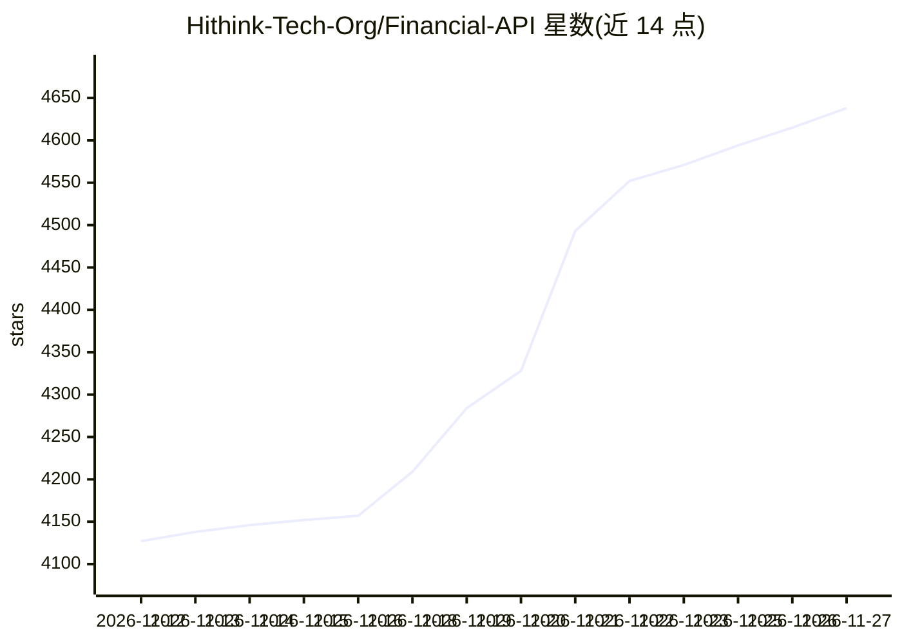

# Hithink-Tech-Org/Financial-API

⭐ 4,638 · TypeScript · MIT · 推送 2026-11-26 · [GitHub](https://github.com/Hithink-Tech-Org/Financial-API) · [官网](https://fuyao.aicubes.cn/) · 组织维护 · 中文 README

**同花顺官方 A股金融数据服务，供 AI Agent 与量化研究取数**

由同花顺官方提供的 A 股金融数据服务（hithink-finance），面向 AI Agent、量化研究者与应用开发者。覆盖最新行情、历史 K 线、集合竞价、财务报表、估值、指数与板块、涨停/龙虎榜等特色数据、公募基金及公开期货期权，并明确列出不提供的分钟 K、tick、Level-2、港美股行情等边界。接入方式包括 REST API、MCP（七个数据域服务）、npm CLI（含内置 Agent Skills）、Python SDK、本地 DuckDB（marketdb）与同花顺AI客户端，统一通过 OAuth 或 API Key 认证。

## 筛选速览

| 维度 | 判定 | 备注 |
|---|---|---|
| AI 角色 | `ai-enhanced` | 去掉 AI 部分产品仍成立 |
| 许可风险 | `permissive` | MIT |
| 部署形态 | `library` | 以包/库形式分发 |
| 模型依赖 | locked-api |  |
| 硬件要求 | — | 无带数字的原话,不猜 |
| 安装摩擦 | `low` | 无编译、无系统依赖或容器化 |
| 成熟度 | — | 结构信号不足 |

## 能力要点

- 统一 API Key 下覆盖行情、财务、指数板块、基金、期货期权等多业务域
- 提供 REST API、MCP、CLI、Python SDK、本地 DuckDB、Agent Skill 多种接入路径
- CLI 内置 Agent Skills，并可为检测到的 Agent 同步 Skills
- marketdb 支持本地构建与增量维护 DuckDB 历史行情库

## 适用场景

- 让 AI Agent 通过 MCP 或 CLI 自动查询和分析 A 股行情与财报
- 在量化研究中用 Python SDK 和本地 DuckDB 做历史行情回测取数
- 在后端服务中用 REST API 集成股票与基金数据
- 批量导出全市场日 K 数据文件落盘研究

## 场景标签

`金融量化` · 领域:学习与行业

## 证据(README 行号)

> L8: **同花顺金融数据服务（hithink-finance）** 是由同花顺官方提供和维护的 A 股金融数据服务，面向 AI Agent、量化研究者和应用开发者。
> L10: 通过统一 API Key，可以查询 A 股行情、集合竞价、财务报表、估值、指数与板块、公募基金、公开期货期权、特色数据及 A 股和港股新股资料，并通过 REST API、MCP、CLI、Python SDK、本地 DuckDB 或
> L155: MCP 适合 Claude Desktop、Cursor、Windsurf 和其他支持 MCP 的客户端。按七个数据域提供接入配置，连接后以实时 `tools/list` 确认可用工具：

## 星数曲线

2026-11-12 4,127 → 2026-11-27 4,638（+511）

---
*卡片 v1 · prompt 1.4 · 生成 2026-11-27 · 置信度 high · 依据 README sha `309694d67587` · [字段定义](../../DATASET.md)*
