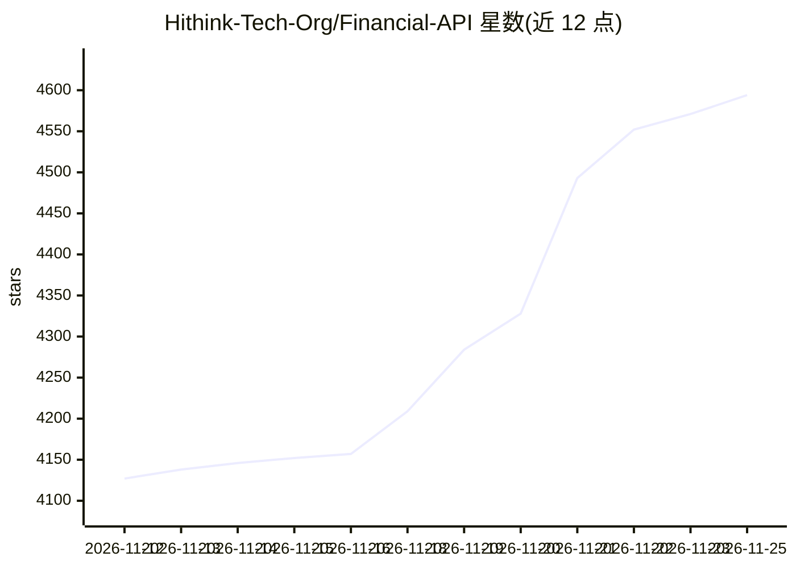

# Hithink-Tech-Org/Financial-API

⭐ 4,594 · TypeScript · MIT · 推送 2026-11-12 · [GitHub](https://github.com/Hithink-Tech-Org/Financial-API) · [官网](https://fuyao.aicubes.cn/) · 组织维护 · 中文 README

**同花顺官方 A 股金融数据服务，支持 API/MCP/CLI/Python 接入**

由同花顺（HiThink）官方维护的 A 股金融数据服务：覆盖股票实时与历史行情、集合竞价、财务报表、估值、指数板块、公募基金、公开期货期权、涨跌停等特色数据及 A 股与港股新股资料。接入方式包括 REST API、托管 MCP 服务、npm 安装的 CLI（含内置 Agent Skills）、Python SDK 与基于 DuckDB 的本地 marketdb。CLI 默认 OAuth 认证，REST/MCP/Python 使用 API Key。不提供分钟 K、Level-2、港美股行情等数据，也不提供投资建议。

## 筛选速览

| 维度 | 判定 | 备注 |
|---|---|---|
| AI 角色 | `ai-ecosystem` | LLM/agent 周边工具 |
| 许可风险 | `permissive` | MIT |
| 部署形态 | `library` | 以包/库形式分发 |
| 模型依赖 | — | README 未给出锁定关系 |
| 硬件要求 | — | 无带数字的原话,不猜 |
| 安装摩擦 | `low` | 无编译、无系统依赖或容器化 |
| 成熟度 | — | 结构信号不足 |

## 能力要点

- REST API、MCP、CLI、Python SDK、DuckDB 本地库、Agent Skill 多种接入方式
- CLI 内置领域 Skills，可发布到用户级目录供 Agent 自动调用
- marketdb 支持本地增量维护 DuckDB 并用 SQL 研究
- 七个数据域的托管 MCP 服务（A 股、指数、元数据、基金、期货、期权、港股新股）

## 适用场景

- 让 AI Agent 在终端或对话中自动查询和分析 A 股金融数据
- 量化研究脚本中获取行情、财务与估值数据
- 本地构建 DuckDB 历史行情库并用 SQL 做回测研究
- 在 Claude Desktop、Cursor 等 MCP 客户端中调用金融数据工具

## 场景标签

`金融量化` `数据分析` · 领域:效率与自动化

## 证据(README 行号)

> L8: **同花顺金融数据服务（hithink-finance）** 是由同花顺官方提供和维护的 A 股金融数据服务，面向 AI Agent、量化研究者和应用开发者。
> L10: 通过统一 API Key，可以查询 A 股行情、集合竞价、财务报表、估值、指数与板块、公募基金、公开期货期权、特色数据及 A 股和港股新股资料，并通过 REST API、MCP、CLI、Python SDK、本地 DuckDB 或

## 星数曲线

2026-11-12 4,127 → 2026-11-25 4,594（+467）

---
*卡片 v1 · prompt 1.4 · 生成 2026-11-17 · 置信度 mid · 依据 README sha `db52de7c8b3e` · [字段定义](../../DATASET.md)*
