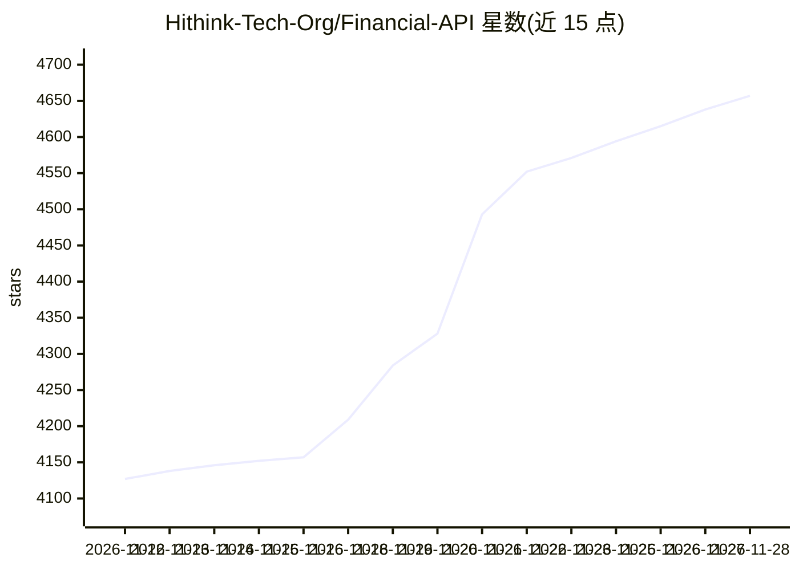

# Hithink-Tech-Org/Financial-API

⭐ 4,657 · HTML · MIT · 推送 2026-11-27 · [GitHub](https://github.com/Hithink-Tech-Org/Financial-API) · [官网](https://fuyao.aicubes.cn/) · 组织维护 · 中文 README

**同花顺官方A股金融数据服务，供 AI Agent 与量化研究取数**

同花顺官方提供和维护的 A 股金融数据服务，仓库汇集接入文档、客户端工具、Agent Skills 与示例。数据覆盖实时/历史行情、财务报表、指数与板块、涨跌停池、龙虎榜、基金与公开期货期权等，经 REST API、MCP、CLI、Python SDK 与 DeepSeek Harness 插件多种接入方式对外提供；CLI 与插件支持同花顺账号 OAuth，API 类接入使用 API Key。分钟 K、tick、Level-2、港股/美股行情等超出公开接入范围，实际权限以账号授权为准。

## 筛选速览

| 维度 | 判定 | 备注 |
|---|---|---|
| AI 角色 | `ai-ecosystem` | LLM/agent 周边工具 |
| 许可风险 | `permissive` | MIT |
| 部署形态 | `library` | 以包/库形式分发 |
| 模型依赖 | — | README 未给出锁定关系 |
| 硬件要求 | — | 无带数字的原话,不猜 |
| 安装摩擦 | `low` | 无编译、无系统依赖或容器化 |
| 成熟度 | — | 结构信号不足 |

## 能力要点

- 覆盖 A 股行情、财报、指数板块、涨跌停/龙虎榜等特色数据
- 提供 REST API、MCP、CLI、Python SDK 与 Agent Skills 多种接入方式
- 支持本地 DuckDB 批量导出与历史数据研究
- CLI 与 DeepSeek Harness 插件支持同花顺账号 OAuth 登录

## 适用场景

- 在 MCP 对话客户端中直接查询行情和财报
- 用 CLI 或 Python 批量取数做量化研究
- 通过 REST API 将行情数据接入自己的应用
- 为 Agent 安装 Skill 提供金融数据工具调用能力

## 场景标签

`金融量化` · 领域:学习与行业

## 证据(README 行号)

> L5:  为 AI Agent、量化研究者和应用开发者提供同花顺官方金融数据
> L23: 同花顺金融数据是同花顺官方提供和维护的金融数据服务。本仓库汇集接入文档、客户端工具、Agent Skills 和示例，方便在 AI 对话、研究脚本和业务应用中使用同一数据服务。
> L29: - **应用集成**。通过 REST API 将金融数据接入网站、App 或后台服务。

## 星数曲线

2026-11-12 4,127 → 2026-11-28 4,657（+530）

---
*卡片 v1 · prompt 1.4 · 生成 2026-11-28 · 置信度 high · 依据 README sha `a82d09c9ed17` · [字段定义](../../DATASET.md)*
