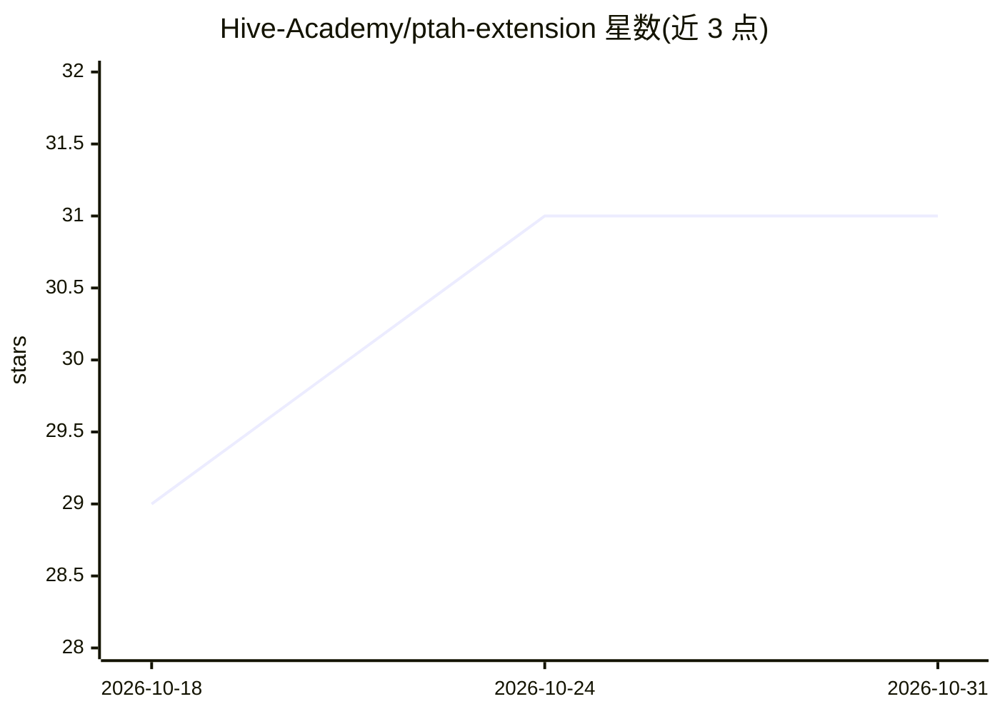

# Hive-Academy/ptah-extension

⭐ 31 · TypeScript · MIT · 推送 2026-10-30 · [GitHub](https://github.com/Hive-Academy/ptah-extension) · [官网](https://ptah.live) · 组织维护

**AI 开发环境：带持久记忆的多智能体编程助手，覆盖桌面/CLI/VS Code**

面向真实项目开发的 AI 编程环境：先用 Tree-sitter 对仓库建索引并维护持久记忆（BM25+向量混合检索），再由主智能体向架构师、前后端、测试、评审等专职子智能体分派任务，每个子智能体可用不同供应商与模型。同一核心提供三种形态：Windows/macOS/Linux 桌面应用、VS Code 扩展、以及基于 stdio JSON-RPC 2.0 的无头 CLI。内置本地 MCP 服务器暴露 ptah_* 工具目录与沙箱代码执行，支持定时任务、Telegram/Discord/Slack 网关触发与逐次工具调用审批。密钥存储在本机系统安全存储中；另有付费社区会员但产品本身 MIT 免费开源。

## 筛选速览

| 维度 | 判定 | 备注 |
|---|---|---|
| AI 角色 | `ai-native` | 本体是模型或模型工具 |
| 许可风险 | `permissive` | MIT |
| 部署形态 | `library` | 以包/库形式分发 |
| 模型依赖 | local-ok | 支持本地模型 |
| 硬件要求 | — | 无带数字的原话,不猜 |
| 安装摩擦 | `low` | 无编译、无系统依赖或容器化 |
| 成熟度 | — | 结构信号不足 |

## 能力要点

- Tree-sitter AST 索引 + BM25/向量混合持久记忆（RRF 融合）
- 主智能体向专职子智能体分派，每个可用独立供应商/模型/上下文窗口
- 内置本地 MCP 服务器（ptah_* 工具目录与沙箱代码执行）及 stdio MCP 模式
- SQLite 定时任务与 Telegram/Discord/Slack 网关，含工具调用审批中继

## 适用场景

- 在日常开发中用一支了解项目架构的 AI 智能体团队完成功能开发
- 在 CI 或脚本中通过无头 CLI 驱动智能体任务
- 让不同厂商模型互相评审代码差异（Tribunal 面板）
- 夜间定时执行安全审查或依赖扫描

## 场景标签

`编码 Agent` `多智能体` `Agent 记忆` · 领域:Agent 开发

## 证据(README 行号)

> L36: Ptah is an AI development environment for real projects. It indexes your repository before the first message, keeps
> L64: - **Sub-agent orchestration** — a main agent delegates to specialists: architect, backend developer, frontend devel

## 星数曲线

2026-10-18 29 → 2026-10-31 31（+2）

---
*卡片 v1 · prompt 1.4 · 生成 2026-10-26 · 置信度 high · 依据 README sha `fe962430c85e` · [字段定义](../../DATASET.md)*
