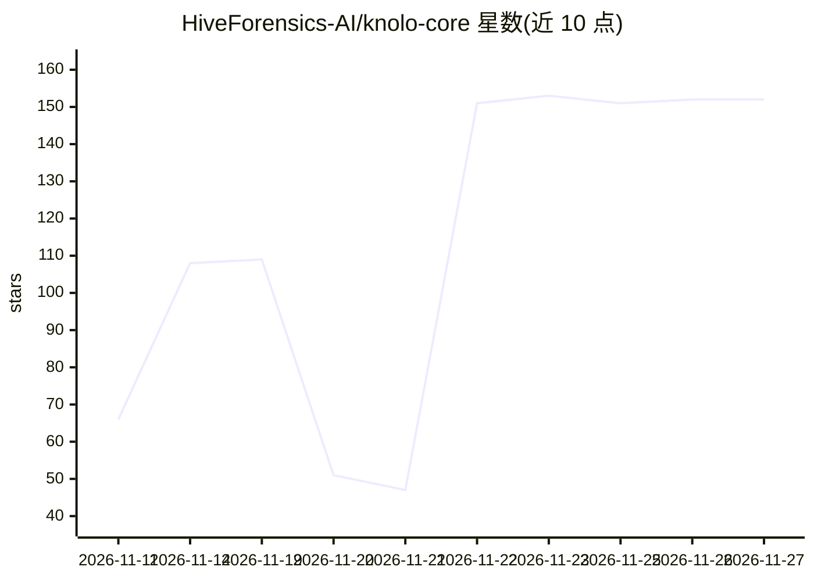

# HiveForensics-AI/knolo-core

⭐ 152 · JavaScript · Apache-2.0 · 推送 2026-11-26 · [GitHub](https://github.com/HiveForensics-AI/knolo-core) · [官网](https://knolo.org) · 组织维护

**让 AI agent 之间打包、验证并共享知识的框架**

Knolo 提供可移植的 Knowledge Image 容器：将源、分块、声明、元数据打包为自包含文件，以 SHA-256 摘要固定，通过 MCP 在本地挂载，查询返回收据与状态根用于完整性核验。V6 的 KAR 依据声明计划检索最小证据集，并提供可验证的证据图与 Cortex 追踪。框架自身不调用模型、不运行 agent，推理由宿主持有；以 npm 包、CLI、Rust/Python 验证器与 ICP canister 形式发布。

## 筛选速览

| 维度 | 判定 | 备注 |
|---|---|---|
| AI 角色 | `ai-ecosystem` | LLM/agent 周边工具 |
| 许可风险 | `permissive` | Apache-2.0 |
| 部署形态 | `library` | 以包/库形式分发 |
| 模型依赖 | local-ok | 支持本地模型 |
| 硬件要求 | — | 无带数字的原话,不猜 |
| 安装摩擦 | `low` | 无编译、无系统依赖或容器化 |
| 成熟度 | — | 结构信号不足 |

## 能力要点

- Knowledge Image 容器：自包含、按摘要固定、可挂载可核验
- KAR：按声明计划做确定性最小证据集检索，评估可重放
- V1–V4 旧工件可验证后确定性迁移到 V5 映像
- 提供 MCP 服务、LangChain/LlamaIndex/ai-sdk 集成与 CLI

## 适用场景

- 把 agent 的知识库打包为可迁移、可审计的文件在多个 agent 间共享
- 对 agent 回答所依据的证据做可重放的检索与覆盖度评估
- 在本地以确定性检索替代向量库构建知识层

## 场景标签

`Agent 框架` `RAG` · 领域:Agent 开发

## 证据(README 行号)

> L3: Knolo is the open framework AI agents use to share knowledge with one
> L11: agent checks the mounted image against its pin. Knolo does not call a
> L50: This is the strategic thesis behind Knolo: a trusted knowledge runtime can become shared infrastructure beneath man

## 星数曲线

2026-11-11 66 → 2026-11-27 152（+86）

---
*卡片 v1 · prompt 1.4 · 生成 2026-11-27 · 置信度 high · 依据 README sha `cd1825e668d3` · [字段定义](../../DATASET.md)*
