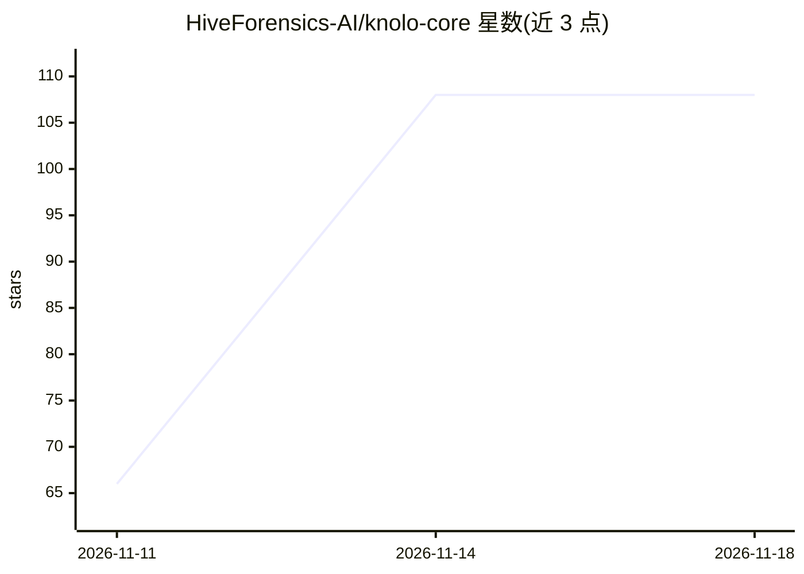

# HiveForensics-AI/knolo-core

⭐ 108 · JavaScript · Apache-2.0 · 推送 2026-11-17 · [GitHub](https://github.com/HiveForensics-AI/knolo-core) · [官网](https://knolo.org) · 组织维护

**AI agent 间共享知识的开源框架：可验证的便携知识镜像**

面向多 agent 系统的知识共享与运行时框架：将知识打包为自包含的 V5 Knowledge Image 文件，以摘要（digest）固定，其他 agent 可在本地挂载并对照 pin 校验完整性。提供确定性 CBOR 编码、域分隔 SHA-256 根、fail-closed 校验、有界 EQL 查询规划与结果回执，以及 V6 KAR 的最小证据集检索与 Committed Evidence Graph。不调用模型、不运行 agent，模型与网络由宿主应用负责。以 npm 包族（core/cli/mcp/tools 等）与 Rust 实现提供，V1-V4 工件可确定性迁移。

## 筛选速览

| 维度 | 判定 | 备注 |
|---|---|---|
| AI 角色 | `ai-ecosystem` | LLM/agent 周边工具 |
| 许可风险 | `permissive` | Apache-2.0 |
| 部署形态 | `library` | 以包/库形式分发 |
| 模型依赖 | local-ok | 支持本地模型 |
| 硬件要求 | — | 无带数字的原话,不猜 |
| 安装摩擦 | `low` | 无编译、无系统依赖或容器化 |
| 成熟度 | — | 结构信号不足 |

## 能力要点

- 知识打包为可校验的便携 Knowledge Image，按 digest 固定与挂载
- 确定性 CBOR 编码、域分隔 SHA-256 根与 fail-closed 容器校验
- KAR 最小证据集检索，评估可重放并输出覆盖报告
- V1-V4 工件可验证后确定性迁移为 V5 创世镜像

## 适用场景

- 让多个 AI agent 之间以可审计方式共享和复用知识库
- 为 RAG/agent 应用提供可验证、可迁移的知识层基础设施
- 对检索所依据的证据做完整性核验与溯源

## 场景标签

`Agent 记忆` · 领域:Agent 开发

## 证据(README 行号)

> L12: model, and it does not run the agent. The short guide is
> L133: The boundary is intentional. Knolo owns the artifact, identity, evidence, roots, validation, deterministic plannin

## 星数曲线

2026-11-11 66 → 2026-11-18 108（+42）

---
*卡片 v1 · prompt 1.4 · 生成 2026-11-17 · 置信度 high · 依据 README sha `74a7bc9521eb` · [字段定义](../../DATASET.md)*
