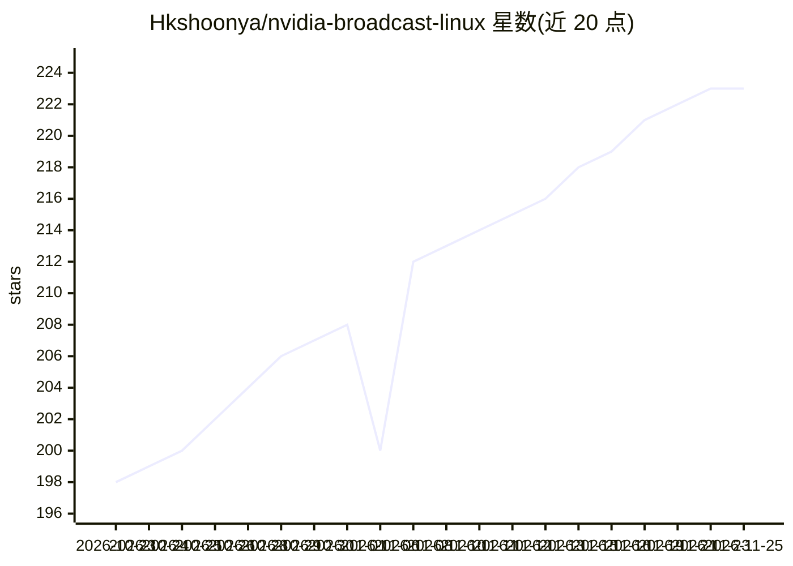

# Hkshoonya/nvidia-broadcast-linux

⭐ 223 · Python · NOASSERTION · 推送 2026-11-08 · [GitHub](https://github.com/Hkshoonya/nvidia-broadcast-linux) · [官网](https://nvbroadcast.com) · 个人维护

**Linux/macOS 上的开源虚拟摄像头与麦克风 AI 效果工具**

非官方的开源 NVIDIA Broadcast 替代实现，面向 Linux 与 macOS 用户。提供 AI 背景模糊/替换、自动构图、人声降噪、麦克风测试等虚拟摄像头与音频效果，并支持 NVENC 硬编码录制 MP4、本地 Whisper 会议转录与本地会议摘要。提供 9 种处理模式（CUDA GPU 推理到纯 CPU 回退），依赖 RVM/IS-Net/BiRefNet 模型（自动下载），通过 install.sh 脚本安装，需要 NVIDIA GTX 1060+ GPU 或使用 CPU 模式。

## 筛选速览

| 维度 | 判定 | 备注 |
|---|---|---|
| AI 角色 | `ai-native` | 本体是模型或模型工具 |
| 许可风险 | `none` | NOASSERTION |
| 部署形态 | `desktop` | 安装包/桌面程序 |
| 模型依赖 | — | README 未给出锁定关系 |
| 硬件要求 | `gpu-8g` | |
| 安装摩擦 | `medium` | 含编译或系统依赖之一 |
| 成熟度 | — | 结构信号不足 |

## 能力要点

- AI 背景模糊/替换/绿幕、自动构图、眼神接触校正与面部补光
- 麦克风/扬声器降噪与 6 种语音预设
- 本地 Whisper 会议转录与本地会议摘要
- 9 种处理模式覆盖 CUDA GPU 到纯 CPU 回退

## 适用场景

- Linux 上为 Zoom/Discord/OBS 等提供背景虚化与虚拟摄像头
- 视频会议中去除键盘与风扇噪声
- 本地录制会议并生成转录与行动项摘要
- 无 CUDA 的旧硬件上以 CPU 模式运行视频效果

## 场景标签

`语音识别` `图像视频处理` · 领域:感知与多模态

## 证据(README 行号)

> L14:  Open-source, unofficial NVIDIA Broadcast alternative for Linux and macOS. AI-powered virtual camera and audio tool
> L65: - **AI Meeting Transcription** — Local Whisper speech-to-text (GPU-accelerated)
> L155: |**GPU**|NVIDIA GTX 1060|RTX 3060 or newer|

## 星数曲线

2026-10-23 198 → 2026-11-25 223（+25）

---
*卡片 v1 · prompt 1.4 · 生成 2026-11-25 · 置信度 mid · 依据 README sha `395d1618b286` · [字段定义](../../DATASET.md)*
