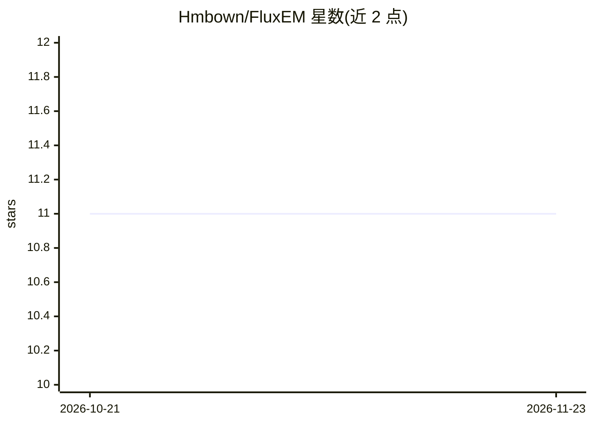

# Hmbown/FluxEM

⭐ 11 · Python · MIT · 推送 2026-04-12 · [GitHub](https://github.com/Hmbown/FluxEM) · [官网](https://hmbown.github.io/FluxEM/index.html) · 个人维护

**面向 LLM 工具调用的确定性工具目录包（核心 35 个工具）**

fluxem-tools 提供确定性工具目录供 LLM 工具调用使用：注册表含 210 个工具、42 个域，受支持的发布范围为算术、数论、物理、化学、生物、统计、金融、时间、信息论 9 个域共 35 个工具。提供 call_tool 调用接口、检索工具的集成示例、Qwen3.5-2B 基准测试脚本与 MCP 服务器（fluxem_search/fluxem_call）。文档建议 7B 以下模型使用检索到的工具子集。旧的代数嵌入研究代码已归档。

## 筛选速览

| 维度 | 判定 | 备注 |
|---|---|---|
| AI 角色 | `ai-ecosystem` | LLM/agent 周边工具 |
| 许可风险 | `permissive` | MIT |
| 部署形态 | `library` | 以包/库形式分发 |
| 模型依赖 | — | README 未给出锁定关系 |
| 硬件要求 | — | 无带数字的原话,不猜 |
| 安装摩擦 | `low` | 无编译、无系统依赖或容器化 |
| 成熟度 | — | 结构信号不足 |

## 能力要点

- 210 个工具、42 个域的注册表，核心发布面为 9 域 35 工具
- 提供 MCP 服务器（fluxem_search/fluxem_call 两个入口）
- 附带 Qwen3.5-2B 基准测试与 OpenAI 兼容集成示例
- 基准显示检索工具子集（max 8）路径准确率 88.9%

## 适用场景

- 为 LLM 的 tool calling 提供确定性计算工具
- 在 Apple Silicon 上用 MLX 本地部署并配合工具调用
- 复现 18 案例 9 域的工具调用基准测试

## 场景标签

 · 领域:LLM 基础设施/工具调用

## 证据(README 行号)

> L21: `fluxem-tools` is a deterministic tool catalog for LLM tool calling. The package registry currently contains 210 to

## 星数曲线

2026-10-21 11 → 2026-11-23 11（+0）

---
*卡片 v1 · prompt 1.4 · 生成 2026-11-19 · 置信度 high · 依据 README sha `cb5304b01872` · [字段定义](../../DATASET.md)*
