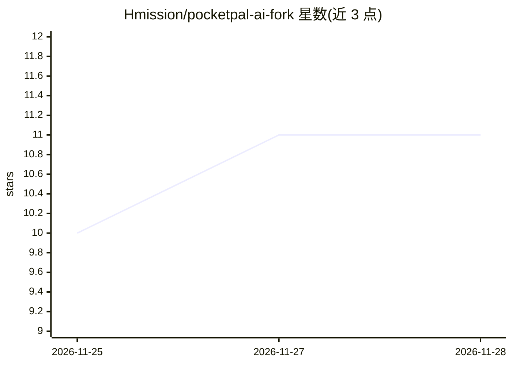

# Hmission/pocketpal-ai-fork

⭐ 11 · C++ · NOASSERTION · 推送 2026-11-12 · [GitHub](https://github.com/Hmission/pocketpal-ai-fork) · 个人维护 · 中文 README

**手机离线运行的端侧开源 AI 伙伴：聊天、生图、语音、绘本、TRPG**

基于 PocketPal AI 二次开发的 React Native 应用，模型经 llama.cpp/llama.rn 与 ONNX Runtime 完全在设备本地推理，不联网、不上传对话。功能覆盖多模型聊天、端侧文生图与图像编辑（DreamLite/SD3.5/Z-Image）、图像反推提示词、RealESRGAN 4× 超分、离线语音转写与合成、智能体工具调用框架与产物工作区。定位为「数字生命玩具」，刻意不做生产力工具。安装需从源码用 yarn 与 gradlew/pod 构建 Android/iOS 应用，真机优化记录集中在 Adreno/Mali GPU。

## 筛选速览

| 维度 | 判定 | 备注 |
|---|---|---|
| AI 角色 | `ai-native` | 本体是模型或模型工具 |
| 许可风险 | `permissive` | NOASSERTION |
| 部署形态 | `None` |  |
| 模型依赖 | local-ok | 支持本地模型 |
| 硬件要求 | — | 无带数字的原话,不猜 |
| 安装摩擦 | `low` | 无编译、无系统依赖或容器化 |
| 成熟度 | — | 结构信号不足 |

## 能力要点

- 完全离线运行：聊天、生图、语音（STT+TTS）均在设备本地推理
- 端侧生图与图像编辑（DreamLite / SD3.5 / Z-Image）+ RealESRGAN 4× 超分
- 从 AIOS 裁剪的端侧智能体工具调用栈与记忆三段治理
- Adreno/Mali OpenCL 内核优化：SD3.5 生成提速至 10.7 分钟级

## 适用场景

- 在无网络环境下用手机与本地大模型聊天
- 手机本地生成与编辑图片并一键超分
- 离线语音对话与音频转写
- 把手机当数字宠物/伙伴进行互动冒险和 TRPG

## 场景标签

`聊天机器人` `图像生成` `语音合成` `语音识别` · 领域:对话与助手

## 证据(README 行号)

> L5: **一款住进手机的开源 AI 伙伴——聊天、生图、玩乐、绘本、冒险，多种玩法全部离线运行在您的设备上**
> L148: - **llama.cpp / llama.rn** — GGUF 大模型端侧推理
> L32: Pocket Chick is intentionally not a productivity tool. It's a "digital pet" — AI doesn't have to be a tool; it can 

## 星数曲线

2026-11-25 10 → 2026-11-28 11（+1）

---
*卡片 v1 · prompt 1.4 · 生成 2026-11-24 · 置信度 high · 依据 README sha `69cf132e8b18` · [字段定义](../../DATASET.md)*
