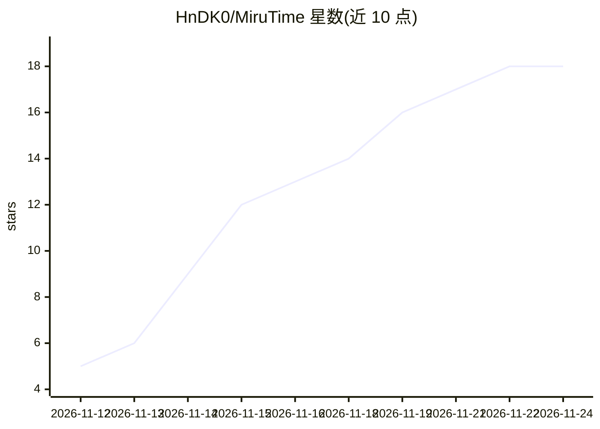

# HnDK0/MiruTime

⭐ 18 · Kotlin · GPL-3.0 · 推送 2026-11-22 · [GitHub](https://github.com/HnDK0/MiruTime) · [官网](https://github.com/HnDK0/MiruTime/releases) · 个人维护

**Android 上的开源小说/漫画/视频阅读器，支持 Lua 插件源与内置翻译**

面向 Android 8.0+ 的免费开源阅读器，覆盖小说、漫画、有声书与视频。内容源以 Lua 插件形式安装（来自仓库或本地 .lua 文件），本地支持 EPUB/FB2/TXT/PDF/CBZ 导入并规定各格式的内存上限。阅读器内置文本翻译（标准与对照模式、章节级翻译队列），提供带后台播放的 TTS、下载管理、书源迁移、备份恢复与 EPUB 导出。翻译需通过外部后端，免费后端与付费 API 均可配置。APK 安装或 Android Studio 源码构建。

## 筛选速览

| 维度 | 判定 | 备注 |
|---|---|---|
| AI 角色 | `ai-enhanced` | 去掉 AI 部分产品仍成立 |
| 许可风险 | `viral` | GPL-3.0 |
| 部署形态 | `None` |  |
| 模型依赖 | — | README 未给出锁定关系 |
| 硬件要求 | — | 无带数字的原话,不猜 |
| 安装摩擦 | `low` | 无编译、无系统依赖或容器化 |
| 成熟度 | — | 结构信号不足 |

## 能力要点

- Lua 插件书源，支持仓库安装与本地 .lua 文件
- 内置章节翻译，支持 OpenAI/Anthropic/Gemini/DeepL/Yandex 等 11 种后端
- TTS 后台播放、下载管理、书源迁移与备份恢复
- 本地 EPUB/FB2/TXT/PDF/CBZ 导入与 OPDS 目录、有声书支持

## 适用场景

- 在 Android 上通过插件源读小说、看漫画和视频
- 阅读外文书籍时在阅读器内直接翻译并保留原文对照
- 下载章节后离线阅读并用 TTS 听书
- 从其他阅读器应用迁移书源与备份

## 场景标签

`语音合成` · 领域:内容生成

## 证据(README 行号)

> L5: Free and open source reader for novels, manga and video on Android.
> L38: - In-reader translation with standard and parallel (original next to translation) modes
> L92: OpenAI-compatible mode works with OpenRouter, Mistral, DeepSeek, Ollama and any compatible endpoint, including loca

## 星数曲线

2026-11-12 5 → 2026-11-24 18（+13）

---
*卡片 v1 · prompt 1.4 · 生成 2026-11-18 · 置信度 high · 依据 README sha `59f3d22e31a9` · [字段定义](../../DATASET.md)*
