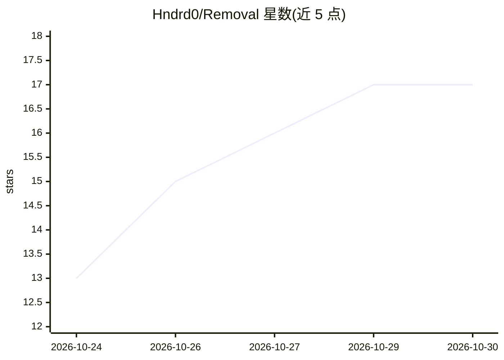

# Hndrd0/Removal

⭐ 17 · TypeScript · 推送 2026-09-13 · [GitHub](https://github.com/Hndrd0/Removal) · [官网](https://removal.ai.studio) · 个人维护

**浏览器端 AI 抠图工具：本地去除图片背景生成透明 PNG**

基于 Web 的图片背景移除应用：上传图片后由二分图像分割模型（IS-Net / U2-Net / BiRefNet）在浏览器内完成分割与边缘抠图，经光晕去污、边缘平滑、孔洞填补等后处理，输出原分辨率 32 位透明 PNG。神经网络通过 WebGPU 执行，自动回退到 WASM SIMD；全程不上传服务器、无遥测，支持 PWA 离线使用。提供源码运行、npm 构建与 Docker 部署方式，附带推理延迟基准测试套件。

## 筛选速览

| 维度 | 判定 | 备注 |
|---|---|---|
| AI 角色 | `ai-native` | 本体是模型或模型工具 |
| 许可风险 | `none` | — |
| 部署形态 | `self-host` | docker 或自建部署 |
| 模型依赖 | — | README 未给出锁定关系 |
| 硬件要求 | — | 无带数字的原话,不猜 |
| 安装摩擦 | `low` | 无编译、无系统依赖或容器化 |
| 成熟度 | — | 结构信号不足 |

## 能力要点

- 100% 客户端推理：WebGPU 加 WASM SIMD 回退，图像不出本机
- IS-Net / U2-Net / BiRefNet 三种分割模型可选
- 光晕去污、边缘感知平滑、孔洞填补后处理管线
- 输出保持原分辨率透明 PNG，支持分屏对比查看与 400% 缩放检视

## 适用场景

- 去除人像或商品图片背景得到透明 PNG
- 在无网络或不愿上传图片的场景下本地抠图
- 自托管部署一个无广告无追踪的抠图服务

## 场景标签

`目标检测` `图像视频处理` · 领域:感知与多模态

## 证据(README 行号)

> L5: > *Upload image → AI segmentation & edge matting → inspect with split comparison → download full-resolution transpar
> L19: 2. **Privacy Comes Second**: **100% client-sided**. The neural network executes entirely inside your device's web b

## 星数曲线

2026-10-24 13 → 2026-10-30 17（+4）

---
*卡片 v1 · prompt 1.4 · 生成 2026-10-30 · 置信度 high · 依据 README sha `5da237aecbaa` · [字段定义](../../DATASET.md)*
