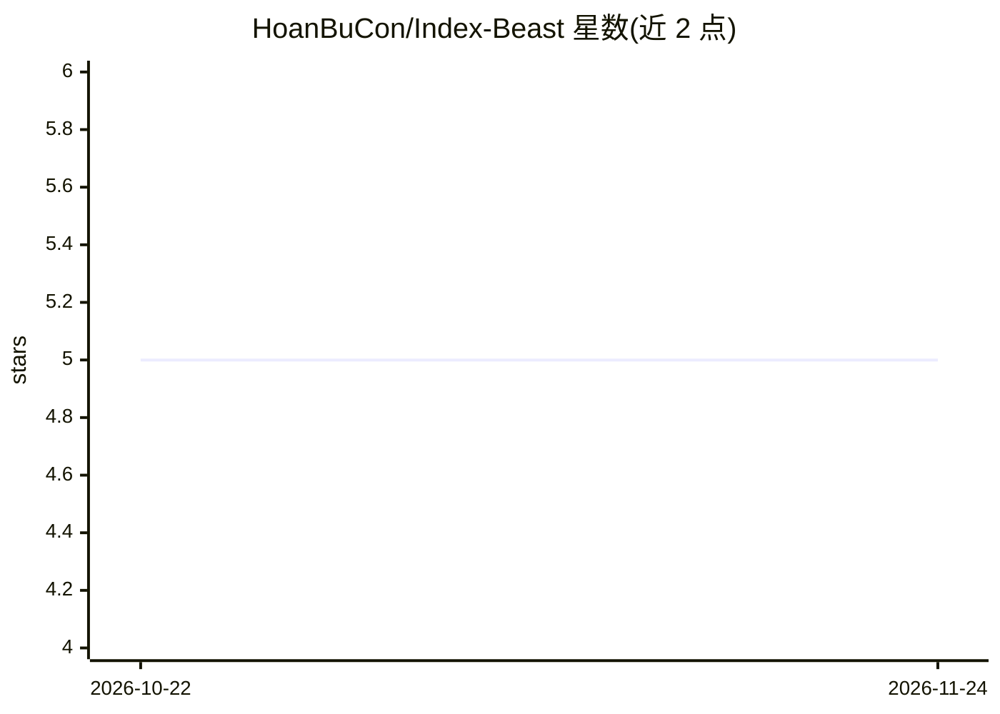

# HoanBuCon/Index-Beast

⭐ — · [GitHub]() · 组织维护

**面向玩家的 Elden Ring 问答助手：网页与 Discord RAG 问答**

越南语团队项目（4 Hollows）：围绕 Elden Ring 语料（含 DLC）构建检索增强问答助手，覆盖 lore、gameplay、任务与出装建议，交付于 Website 和 Discord bot。当前处于基础阶段：FastAPI 健康检查、配置与 DeepSeek 适配器已实现；数据摄取与 RAG pipeline 按 sprint 计划开发中。聊天提供 mock / llm_only / rag 三种服务端模式；检索方案为 hybrid search + 可选 rerank + DeepSeek，另有 E5 ONNX + BM25 + Qdrant RRF 的 baseline notebook（交付时未执行）。

## 筛选速览

| 维度 | 判定 | 备注 |
|---|---|---|
| AI 角色 | `ai-native` | 本体是模型或模型工具 |
| 许可风险 | `permissive` | — |
| 部署形态 | `self-host` | docker 或自建部署 |
| 模型依赖 | — | README 未给出锁定关系 |
| 硬件要求 | — | 无带数字的原话,不猜 |
| 安装摩擦 | `low` | 无编译、无系统依赖或容器化 |
| 成熟度 | `idea` | |

## 能力要点

- 三种聊天服务端模式：mock（默认）/ llm_only / rag
- RAG 方案：hybrid search + 可选 rerank + DeepSeek
- baseline notebook 使用 E5 ONNX + BM25 + Qdrant RRF
- 后端 FastAPI、前端 React、Discord bot，docker-compose 编排 PostgreSQL/Qdrant/Redis

## 适用场景

- 玩家查询 Elden Ring 的 lore、任务流程与出装建议
- 在 Discord 服务器内以斜杠命令进行游戏问答
- 作为团队 RAG 工程实践的参考仓库结构

## 场景标签

`聊天机器人` `RAG` · 领域:对话与助手

## 证据(README 行号)

> L7: Dự án **IndexBeast** của nhóm **4 Hollows**: trợ lý hỏi đáp **Elden Ring và nội dung liên quan trong corpus**, gồm D
> L14: Chat hiện có ba mode server: `mock` (mặc định), `llm_only` và `rag`. Xem
> L50: |`backend/ingest/`|Pipeline offline: crawl → filter → transform → chunk → index|TV2, TV3|

## 星数曲线

2026-10-22 5 → 2026-11-24 5（+0）

---
*卡片 v1 · prompt 1.4 · 生成 2026-11-21 · 置信度 high · 依据 README sha `61a59d94efa3` · [字段定义](../../DATASET.md)*
