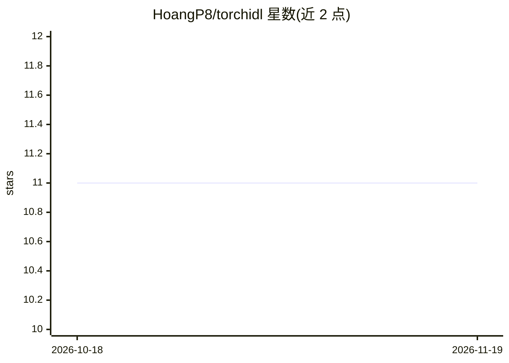

# HoangP8/torchidl

⭐ 11 · Python · MIT · 推送 2026-04-02 · [GitHub](https://github.com/HoangP8/torchidl) · 组织维护

**面向 PyTorch 用户的隐式深度学习模型实现库**

基于 PyTorch 的隐式模型库：通过求解不动点方程确定隐状态，提供基础 ImplicitModel、循环变体 ImplicitRNN，以及利用预训练网络合成训练数据、将训练表述为凸优化问题的 SIM 训练方法。内置 CVX、ADMM、多 GPU ADMM、低秩投影梯度、最小二乘等多种求解器，支持通过 BaseSolver 类自定义求解器。以 PyPI 包发布，附文档站、Notebook 教程与示例脚本。

## 筛选速览

| 维度 | 判定 | 备注 |
|---|---|---|
| AI 角色 | `ai-native` | 本体是模型或模型工具 |
| 许可风险 | `permissive` | MIT |
| 部署形态 | `library` | 以包/库形式分发 |
| 模型依赖 | — | README 未给出锁定关系 |
| 硬件要求 | — | 无带数字的原话,不猜 |
| 安装摩擦 | `low` | 无编译、无系统依赖或容器化 |
| 成熟度 | — | 结构信号不足 |

## 能力要点

- 提供 ImplicitModel 与 ImplicitRNN 模型实现
- SIM 训练方法将隐式模型训练表述为凸优化问题
- 内置 5 种求解器并支持自定义 BaseSolver 扩展
- ADMMMultiGPUSolver 支持多 GPU 分布式训练

## 适用场景

- 构建和实验隐式深度学习模型
- 用预训练网络通过 SIM 方法训练稀疏且鲁棒的隐式模型
- 在多 GPU 上分布式训练隐式模型

## 场景标签

`模型训练` · 领域:训练与推理

## 证据(README 行号)

> L24: Traditional feedforward neural networks compute hidden states by passing inputs sequentially through layers. In con
> L91: The `torchidl` package provides a comprehensive framework for implementing and experimenting with implicit models. 

## 星数曲线

2026-10-18 11 → 2026-11-19 11（+0）

---
*卡片 v1 · prompt 1.4 · 生成 2026-11-19 · 置信度 high · 依据 README sha `b3f08282ddc3` · [字段定义](../../DATASET.md)*
