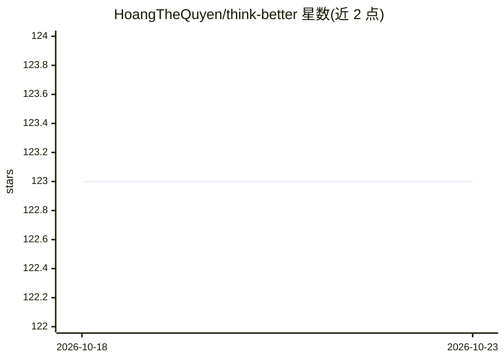

# HoangTheQuyen/think-better

⭐ 123 · Python · MIT · 推送 2026-10-22 · [GitHub](https://github.com/HoangTheQuyen/think-better) · [官网](https://thinkbetter.dev) · 个人维护

**给 AI 编码助手装结构化思维技能的 CLI（3 技能 20 命令）**

一个 CLI 工具，向 Claude Code、GitHub Copilot、Antigravity、OpenCode 四种 AI 编码工具安装三个技能（决策、问题求解、代码修改）及其斜杠命令，共 326 条知识记录、20 个命令。/code 采用 7 步带门禁流程，每步需证据（失败测试、检查通过）方可继续；知识库本地检索，脚本本地运行、无网络调用与 API key。需 Python 3（仅标准库），知识库与触发短语为英文，英文请求匹配效果最好。

## 筛选速览

| 维度 | 判定 | 备注 |
|---|---|---|
| AI 角色 | `ai-ecosystem` | LLM/agent 周边工具 |
| 许可风险 | `permissive` | MIT |
| 部署形态 | `None` |  |
| 模型依赖 | locked-api |  |
| 硬件要求 | — | 无带数字的原话,不猜 |
| 安装摩擦 | `low` | 无编译、无系统依赖或容器化 |
| 成熟度 | — | 结构信号不足 |

## 能力要点

- 3 技能（决策/求解/代码）+ 20 个斜杠命令，适配 4 种 AI 编码工具
- 326 条知识记录本地检索，脚本无网络调用与账号
- /code 7 步带门禁流程，需失败测试与项目自有检查作为证据
- 可保存分步 Markdown 工作区并跨会话续作

## 适用场景

- 让 Claude Code/Copilot 等 AI 助手按固定框架做技术选型
- 以带证据门禁的流程做代码调试与变更
- 用结构化 7 步法分析业务或产品问题

## 场景标签

`提示工程` · 领域:Agent 开发

## 证据(README 行号)

> L6: One CLI installs three skills and their slash commands so your AI decides with real frameworks,
> L15: **Works with** Claude Code · GitHub Copilot · Antigravity · OpenCode

## 星数曲线

2026-10-18 123 → 2026-10-23 123（+0）

---
*卡片 v1 · prompt 1.4 · 生成 2026-10-23 · 置信度 high · 依据 README sha `2670f4e1ef73` · [字段定义](../../DATASET.md)*
