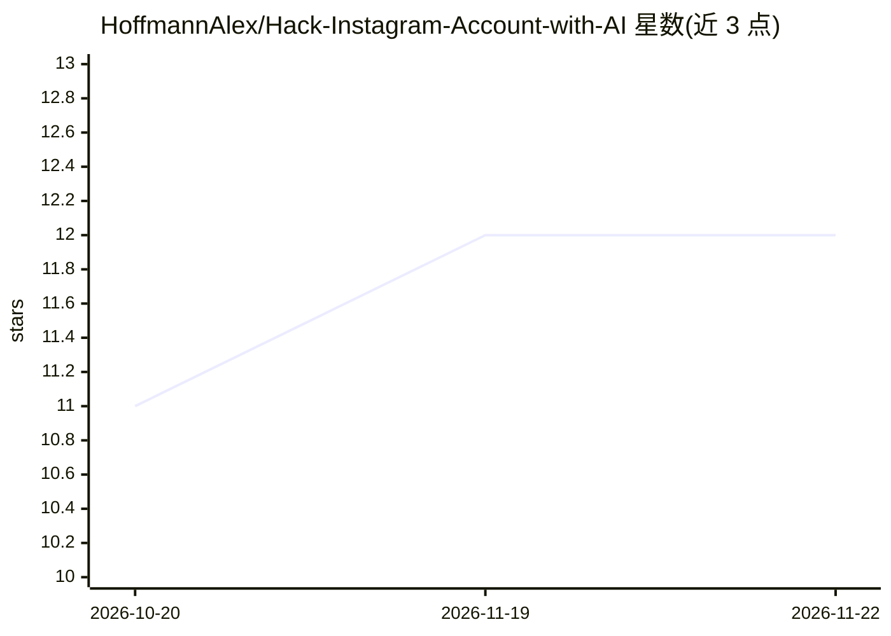

# HoffmannAlex/Hack-Instagram-Account-with-AI

⭐ 12 · Python · NOASSERTION · 推送 2026-11-14 · [GitHub](https://github.com/HoffmannAlex/Hack-Instagram-Account-with-AI) · [官网](https://www.passwordrevelator.net/en/passdecryptor) · 个人维护

**面向自有 Instagram 账号的授权密码强度测试工具**

Python 编写的 Instagram 密码强度测试工具，声称用于弱密码漏洞演示与安全意识教育，仅限测试自有或获书面授权的账号。功能包括四种攻击策略（字典、掩码、组合、暴力）、代理轮换、Tor 集成、请求节流、实时统计与报告。通过 git clone 与 pip 安装依赖运行。README 中实际描述的机制为模式化密码生成与词表测试，未给出机器学习模型的实现细节；头部声明依赖第三方 PASS REVELATOR API。

## 筛选速览

| 维度 | 判定 | 备注 |
|---|---|---|
| AI 角色 | `ai-enhanced` | 去掉 AI 部分产品仍成立 |
| 许可风险 | `none` | NOASSERTION |
| 部署形态 | `library` | 以包/库形式分发 |
| 模型依赖 | — | README 未给出锁定关系 |
| 硬件要求 | — | 无带数字的原话,不猜 |
| 安装摩擦 | `low` | 无编译、无系统依赖或容器化 |
| 成熟度 | — | 结构信号不足 |

## 能力要点

- 四种攻击策略：字典、掩码、组合、暴力
- 代理轮换与 Tor 集成的匿名化选项
- 实时攻击统计与详细日志报告
- CSRF token 处理与 CAPTCHA 检测

## 适用场景

- 测试自己 Instagram 账号的密码强度
- 安全培训课程中演示弱密码风险
- 密码策略教学时生成掩码与组合变体样本

## 场景标签

`网络安全` · 领域:学习与行业

## 证据(README 行号)

> L24: Hack Instagram Password is an advanced security testing tool designed to demonstrate the vulnerabilities of weak pa
> L37: * **Dictionary Attacks**: Test common passwords and wordlists
> L11: **I used the PASS REVELATOR API, which I thank, to create this program. If you want to learn more about Instagram a

## 星数曲线

2026-10-20 11 → 2026-11-22 12（+1）

---
*卡片 v1 · prompt 1.4 · 生成 2026-11-19 · 置信度 mid · 依据 README sha `0159a9e49550` · [字段定义](../../DATASET.md)*
