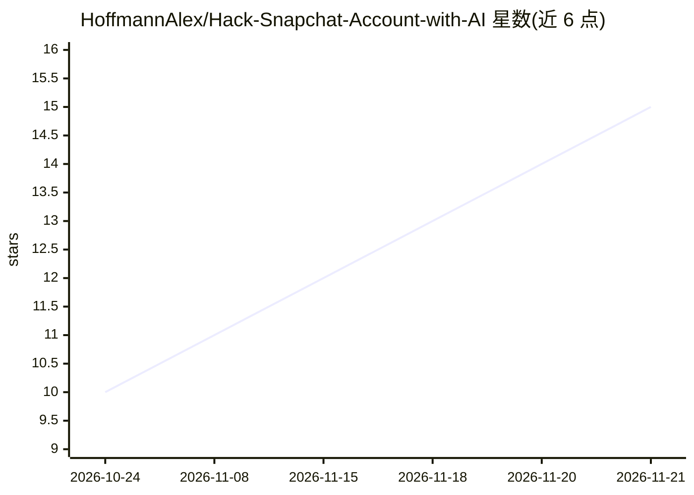

# HoffmannAlex/Hack-Snapchat-Account-with-AI

⭐ 15 · Python · NOASSERTION · 推送 2026-11-14 · [GitHub](https://github.com/HoffmannAlex/Hack-Snapchat-Account-with-AI) · [官网](https://www.passwordrevelator.net/en/passdecoder) · 个人维护

**面向授权测试的 Snapchat 密码强度评估工具**

README 自述为网络安全训练用途的密码评估工具，围绕 Snapchat 账户口令演示弱密码被猜解的过程。提供字典、掩码模板、组合变换、穷举四种测试策略，配合代理轮换、Tor 路由、自适应限速与 User-Agent 随机化等匿名化选项，并输出实时统计与日志报告。运行依赖 Python 3.8+，经 git clone 后 pip 安装依赖使用。README 声称使用 PASS REVELATOR API，并反复强调仅限拥有授权的账户测试。

## 筛选速览

| 维度 | 判定 | 备注 |
|---|---|---|
| AI 角色 | `ai-native` | 本体是模型或模型工具 |
| 许可风险 | `none` | NOASSERTION |
| 部署形态 | `library` | 以包/库形式分发 |
| 模型依赖 | — | README 未给出锁定关系 |
| 硬件要求 | — | 无带数字的原话,不猜 |
| 安装摩擦 | `low` | 无编译、无系统依赖或容器化 |
| 成熟度 | — | 结构信号不足 |

## 能力要点

- 四种密码测试策略：字典、掩码生成、组合变换、穷举
- 匿名化选项：代理轮换、Tor 支持、限速、UA 随机化
- 执行期实时统计、资源占用跟踪与日志报告
- 自述采用 PASS REVELATOR API，处理 CSRF token 与会话

## 适用场景

- 在自有账户上评估密码强度
- 网络安全课程中演示密码攻击方法
- 学习密码脆弱性与加固实践

## 场景标签

`网络安全` · 领域:学习与行业

## 证据(README 行号)

> L25: The **Snapchat Password Security Assessment Tool** is a cybersecurity training utility designed to demonstrate how 
> L38: - Dictionary Testing: Uses common and custom wordlists.

## 星数曲线

2026-10-24 10 → 2026-11-21 15（+5）

---
*卡片 v1 · prompt 1.4 · 生成 2026-11-18 · 置信度 mid · 依据 README sha `edaf96c53c7e` · [字段定义](../../DATASET.md)*
