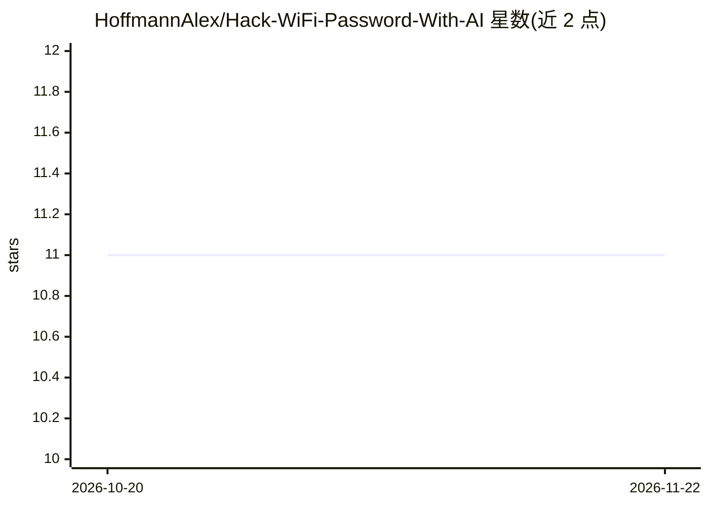

# HoffmannAlex/Hack-WiFi-Password-With-AI

⭐ 11 · Python · 推送 2026-11-15 · [GitHub](https://github.com/HoffmannAlex/Hack-WiFi-Password-With-AI) · [官网](https://www.passwordrevelator.net/en/passwifi) · 个人维护

**AI 生成候选密码的 WiFi 握手包破解工具**

Python 编写的 WiFi 密码破解工具，流程为捕获 WPA 四次握手（配合 deauth 攻击强制客户端重连）、再用 AI 上下文感知生成候选密码，集成 aircrack-ng 引擎进行破解。README 声称支持 WEP/WPA/WPA2、监控模式与数据包注入，提供自定义字典、指定 BSSID/信道、隐身模式等命令行选项。许可仅限教育用途与授权渗透测试，声明商业使用需另行许可，并强调未经授权使用违法。需支持注入/监控模式的无线网卡。

## 筛选速览

| 维度 | 判定 | 备注 |
|---|---|---|
| AI 角色 | `ai-enhanced` | 去掉 AI 部分产品仍成立 |
| 许可风险 | `none` | — |
| 部署形态 | `None` |  |
| 模型依赖 | — | README 未给出锁定关系 |
| 硬件要求 | — | 无带数字的原话,不猜 |
| 安装摩擦 | `low` | 无编译、无系统依赖或容器化 |
| 成熟度 | — | 结构信号不足 |

## 能力要点

- 捕获 WPA 四次握手并配合 deauth 攻击触发重连
- AI 上下文感知密码生成，自称比暴力破解快 3 倍
- 集成 aircrack-ng 作为破解引擎
- 支持自定义字典、指定 BSSID/信道与隐身模式参数

## 适用场景

- 授权渗透测试中评估无线网络弱口令风险
- 安全教学中演示握手捕获与破解流程
- 检查自家网络密码是否易被上下文猜测

## 场景标签

`网络安全` · 领域:学习与行业

## 证据(README 行号)

> L31: * **🤖 AI-Powered Cracking** — Context-aware password generation
> L33: * **🔓 Aircrack-ng Integration** — Industry-standard cracking engine
> L128: **Educational Use License** — This hacking tool is provided for:

## 星数曲线

2026-10-20 11 → 2026-11-22 11（+0）

---
*卡片 v1 · prompt 1.4 · 生成 2026-11-19 · 置信度 mid · 依据 README sha `fa15fe34aa85` · [字段定义](../../DATASET.md)*
