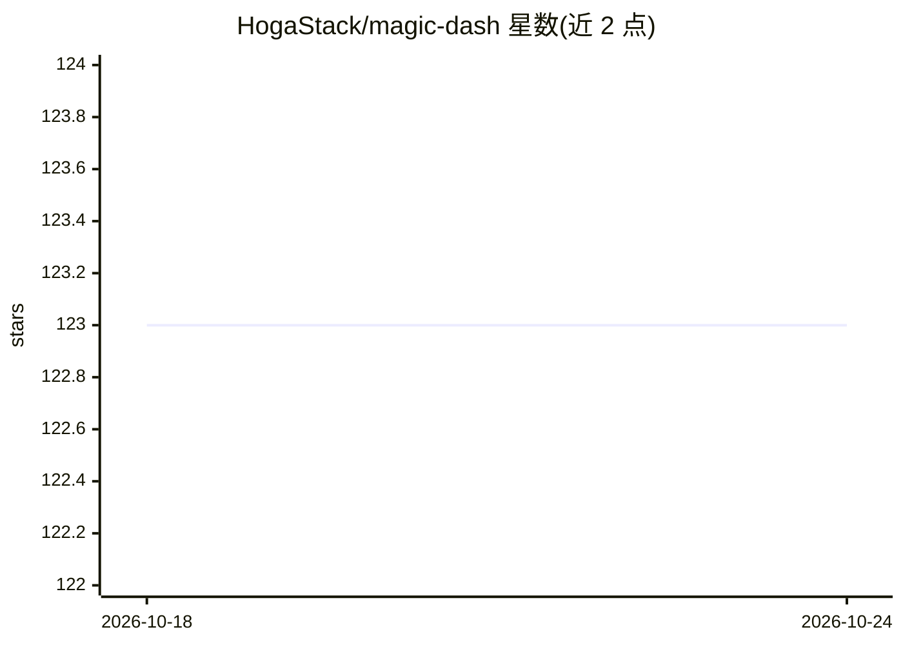

# HogaStack/magic-dash

⭐ 123 · Python · MIT · 推送 2026-08-30 · [GitHub](https://github.com/HogaStack/magic-dash) · 个人维护 · 中文 README

**面向 Dash 应用的 Python 命令行项目脚手架**

magic-dash 是一个 CLI 脚手架工具，通过 pip 安装后可用 magic-dash create 交互式或参数化地生成可运行的 Python 数据应用项目。内置三种模板：simple-tool（单页面工具）、magic-dash（多页面持续扩展应用，含侧边菜单、路由、状态页）、magic-dash-pro（含复杂用户与部门关系、多种登录方式与鉴权的管理系统模板）。创建时可选择 FastAPI 等后端类型，生成后安装依赖并运行 app.py 即可访问。README 未展示 AI 相关功能，AI 仅出现在仓库主题标签中。

## 筛选速览

| 维度 | 判定 | 备注 |
|---|---|---|
| AI 角色 | `ai-enhanced` | 去掉 AI 部分产品仍成立 |
| 许可风险 | `permissive` | MIT |
| 部署形态 | `library` | 以包/库形式分发 |
| 模型依赖 | — | README 未给出锁定关系 |
| 硬件要求 | — | 无带数字的原话,不猜 |
| 安装摩擦 | `low` | 无编译、无系统依赖或容器化 |
| 成熟度 | — | 结构信号不足 |

## 能力要点

- 三种内置模板：单页面工具、多页面应用、带用户体系的管理系统
- 交互式或参数化指定模板与后端类型（如 FastAPI）生成项目
- CLI 自动复制 pro 模板公共静态资源到生成项目

## 适用场景

- 快速搭建 Dash 数据可视化应用的工程起点
- 生成带用户登录与鉴权的管理系统模板
- 快速创建单页面内部小工具原型

## 场景标签

`代码生成` · 领域:编码与开发

## 证据(README 行号)

> L10: `magic-dash`是面向Dash应用开发的命令行脚手架，用于快速生成可运行、可扩展的`Python`数据应用项目。它内置单页面工具、多页面持续扩展应用和支持复杂用户与部门关系的管理系统模板，覆盖路由、菜单、配置、回调组织、状
> L42: - `simple-tool`

## 星数曲线

2026-10-18 123 → 2026-10-24 123（+0）

---
*卡片 v1 · prompt 1.4 · 生成 2026-10-23 · 置信度 low · 依据 README sha `0273315eedb8` · [字段定义](../../DATASET.md)*
