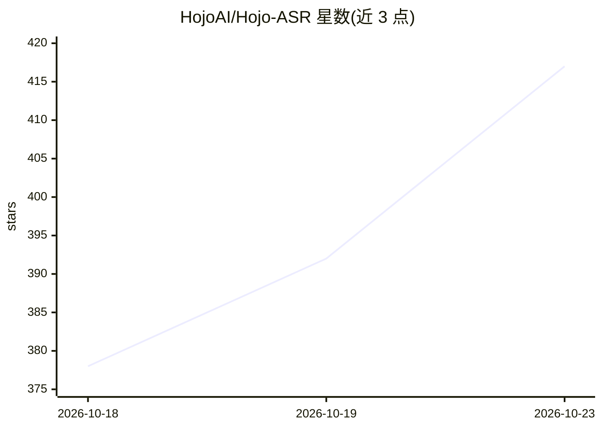

# HojoAI/Hojo-ASR

⭐ 417 · Python · Apache-2.0 · 推送 2026-05-26 · [GitHub](https://github.com/HojoAI/Hojo-ASR) · 组织维护

**基于 Qwen3 LLM 解码器的中英粤川对话语音识别模型**

Hojo-ASR-V1 是采用 Encoder-Adapter-LLM 架构的语音识别模型，声学编码器经适配层连接 Qwen3 LLM 解码器。经多阶段模块化训练与强化学习优化，面向噪声环境、非正式发音、口语修正与中英混说等场景，支持普通话、英语、粤语和四川话识别。以 Python 包（hojo-asr）形式从 PyPI 安装，提供 transformers 后端推理，并在多个公开英文数据集上公布 WER 基准。由 HojoAI 团队维护，提供商业支持与企业授权洽谈渠道。

## 筛选速览

| 维度 | 判定 | 备注 |
|---|---|---|
| AI 角色 | `ai-native` | 本体是模型或模型工具 |
| 许可风险 | `permissive` | Apache-2.0 |
| 部署形态 | `library` | 以包/库形式分发 |
| 模型依赖 | — | README 未给出锁定关系 |
| 硬件要求 | — | 无带数字的原话,不猜 |
| 安装摩擦 | `low` | 无编译、无系统依赖或容器化 |
| 成熟度 | — | 结构信号不足 |

## 能力要点

- Encoder-Adapter-LLM 架构，解码器为 Qwen3
- 支持普通话、英语、粤语、四川话及中英混说
- 面向噪声、非正式发音等复杂场景的多阶段训练与强化学习优化
- PyPI 提供 hojo-asr Python 包，transformers 后端推理

## 适用场景

- 工业场景下的对话语音转写
- 中英混说与方言（粤语/四川话）语音识别
- 将 ASR 能力集成到自有产品中（含商业授权）

## 场景标签

`语音识别` · 领域:感知与多模态

## 证据(README 行号)

> L7: Hojo-ASR-V1 is a high-performance conversational speech recognition model powered by the Qwen3 LLM decoder. It adopt
> L9: Optimized with multi-stage modular training and reinforcement learning, the model specializes in complex real-world 

## 星数曲线

2026-10-18 378 → 2026-10-23 417（+39）

---
*卡片 v1 · prompt 1.4 · 生成 2026-10-22 · 置信度 high · 依据 README sha `125c98b50637` · [字段定义](../../DATASET.md)*
