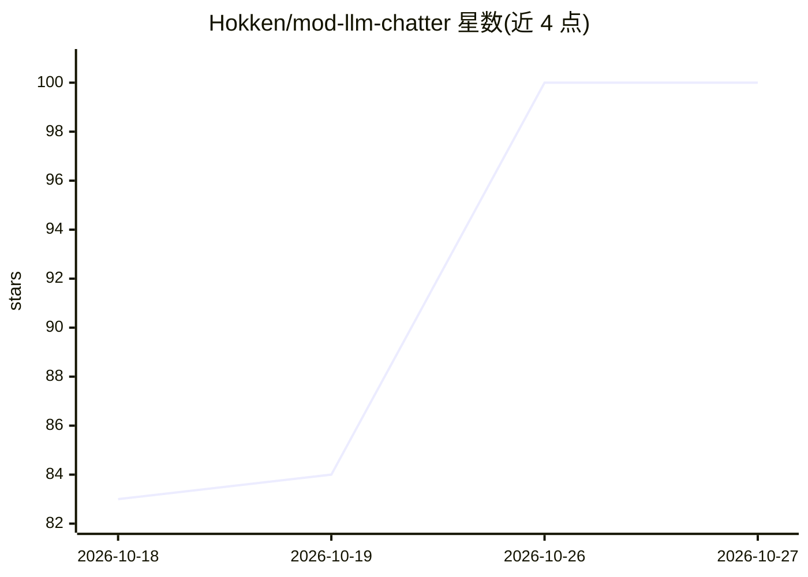

# Hokken/mod-llm-chatter

⭐ 100 · Python · AGPL-3.0 · 推送 2026-10-26 · [GitHub](https://github.com/Hokken/mod-llm-chatter) · 个人维护

**给 WoW 私服玩家机器人加 LLM 角色扮演对话的模块**

AzerothCore WotLK 3.3.5a + mod-playerbots 的服务器模块：把自动机器人替换为有性格、基于设定的对话伙伴。机器人按种族/职业/天赋/背景故事发言，具备持久记忆、3000+ 区域描述的位置感知、队友互动、PvP 反应、公会与公共频道闲聊。LLM 调用在独立的 Python 桥接服务中并发执行，worldserver 不阻塞。支持 Anthropic/OpenAI/Gemini/OpenRouter/Ollama 及任意 OpenAI 兼容服务器，可选 JSON Schema 结构化输出。需编译 AzerothCore，Python 3.10+。

## 筛选速览

| 维度 | 判定 | 备注 |
|---|---|---|
| AI 角色 | `ai-native` | 本体是模型或模型工具 |
| 许可风险 | `viral` | AGPL-3.0 |
| 部署形态 | `self-host` | docker 或自建部署 |
| 模型依赖 | local-ok | 支持本地模型 |
| 硬件要求 | — | 无带数字的原话,不猜 |
| 安装摩擦 | `low` | 无编译、无系统依赖或容器化 |
| 成熟度 | — | 结构信号不足 |

## 能力要点

- 机器人具备持久身份、生成的背景故事与共同经历记忆
- 3000+ 区域/子区域描述实现位置与世界感知
- LLM 调用在独立并发 Python 桥接服务中运行，worldserver 不阻塞
- 支持 Anthropic/OpenAI/Gemini/OpenRouter/Ollama/OpenAI 兼容服务，可选 JSON Schema 结构化输出

## 适用场景

- 让私服中的 party 机器人以角色身份对话，增强沉浸感
- 在地下城、PvP、公会频道中获得机器人同伴的情境化发言
- 通过游戏内插件查看和修改机器人性格与背景故事

## 场景标签

`聊天机器人` · 领域:对话与助手

## 证据(README 行号)

> L7: A fantasy roleplay conversation engine for AzerothCore WotLK (3.3.5a) and mod-playerbots. It replaces the silence of
> L48: * **Non-blocking architecture**: LLM work runs in a separate, concurrent
> L84: |LLM Provider|Anthropic, OpenAI, Google Gemini, OpenRouter, Ollama, or any OpenAI-compatible server|

## 星数曲线

2026-10-18 83 → 2026-10-27 100（+17）

---
*卡片 v1 · prompt 1.4 · 生成 2026-10-24 · 置信度 high · 依据 README sha `e0bf14249947` · [字段定义](../../DATASET.md)*
