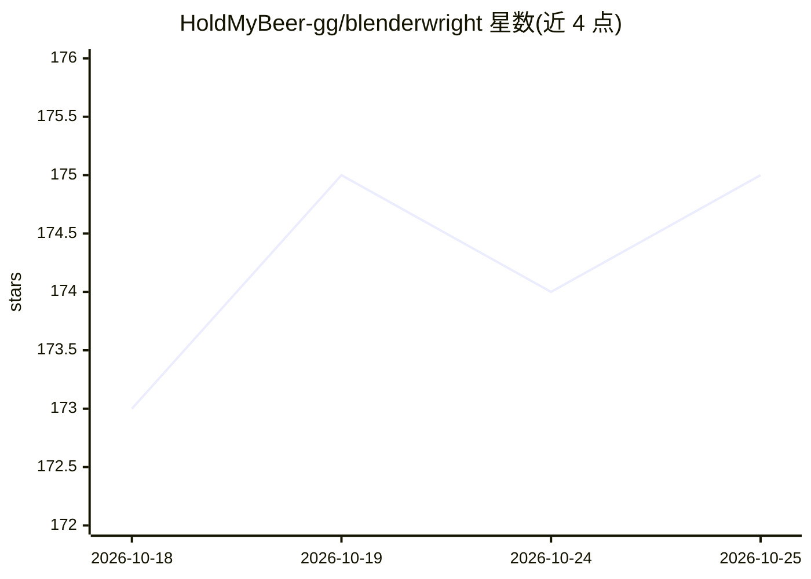

# HoldMyBeer-gg/blenderwright

⭐ 175 · Python · MIT · 推送 2026-10-24 · [GitHub](https://github.com/HoldMyBeer-gg/blenderwright) · [官网](https://blenderwright.holdmybeer.gg/) · 个人维护

**Blender 的 MCP server：191 个工具让 AI 助手用自然语言做 3D 建模**

面向使用 Claude 等 MCP 客户端的开发者的 Blender 控制层：以标准 MCP server（stdio 传输）加 Blender 插件（TCP 后台服务）形式提供，暴露 191 个工具覆盖建模、网格编辑、材质、灯光、渲染、动画、雕刻等 28 个模块，并配 12 个专家 prompt 与视口截图自动评审反馈循环引导 LLM 产出专业结果。支持 uvx/pip 安装服务端、zip 安装插件；要求 Blender 4.2+，本地运行、零遥测。原始 Python 执行为可选项且默认关闭。

## 筛选速览

| 维度 | 判定 | 备注 |
|---|---|---|
| AI 角色 | `ai-ecosystem` | LLM/agent 周边工具 |
| 许可风险 | `permissive` | MIT |
| 部署形态 | `desktop` | 安装包/桌面程序 |
| 模型依赖 | locked-api |  |
| 硬件要求 | — | 无带数字的原话,不猜 |
| 安装摩擦 | `low` | 无编译、无系统依赖或容器化 |
| 成熟度 | — | 结构信号不足 |

## 能力要点

- 191 个工具覆盖 28 个 Blender 功能模块
- 12 个专家 prompt 与视口截图自动评审反馈循环
- 网格质量分析（非流形边、松散顶点、零面积面等）
- 零依赖插件（仅 Python stdlib + bpy），本地 127.0.0.1 运行、零遥测

## 适用场景

- 通过 Claude 等 AI 助手用自然语言在 Blender 中建模、布光和渲染
- 让 LLM 自动检查并修复网格质量缺陷
- 为任意 MCP 客户端接入 Blender 场景操作能力

## 场景标签

 · 领域:3D 创作/AI 工具集成

## 证据(README 行号)

> L5: The most intuitive and efficient MCP Server for Blender. Control Blender entirely through AI assistants like Claude:
> L120: blenderwright is a standard MCP server using stdio transport. Any MCP-compatible client can connect by running the
> L129: The server communicates over stdin/stdout using the MCP protocol. It connects to Blender's addon over TCP on `127.

## 星数曲线

2026-10-18 173 → 2026-10-25 175（+2）

---
*卡片 v1 · prompt 1.4 · 生成 2026-10-22 · 置信度 high · 依据 README sha `26681cace48b` · [字段定义](../../DATASET.md)*
