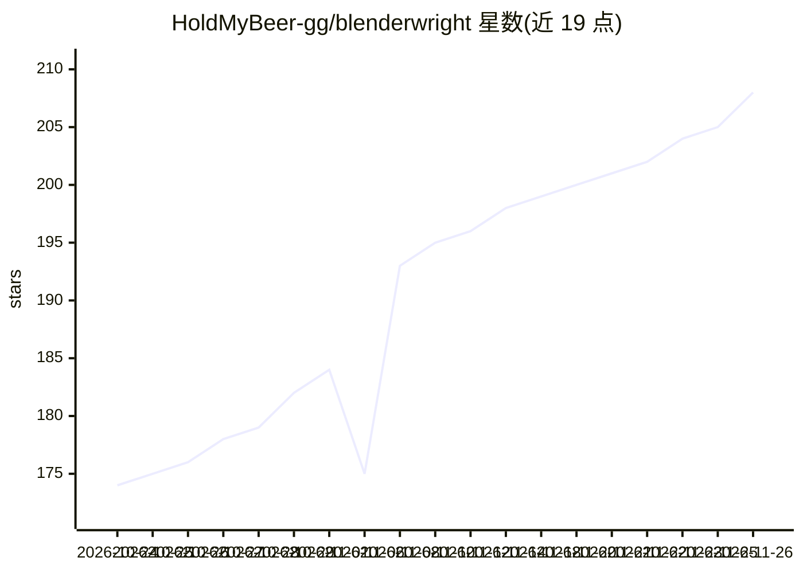

# HoldMyBeer-gg/blenderwright

⭐ 208 · Python · MIT · 推送 2026-11-23 · [GitHub](https://github.com/HoldMyBeer-gg/blenderwright) · [官网](https://blenderwright.holdmybeer.gg/) · 个人维护

**面向 AI 助手的 Blender MCP 服务器，自然语言驱动建模渲染**

作为 MCP 服务器连接 AI 客户端与 Blender：提供 279 个工具、覆盖建模、材质、灯光、动画、渲染、几何节点等领域，并内置 13 个专家提示词、视口截图视觉反馈回路与网格质量分析来引导 LLM 产出结果。安全机制上采用 HMAC-SHA256 签名本地 socket，原始 Python 执行默认关闭、需按会话开启。要求 Blender 5.2 LTS，无遥测、本地运行；不支持的旧版 Blender 无法安装。

## 筛选速览

| 维度 | 判定 | 备注 |
|---|---|---|
| AI 角色 | `ai-ecosystem` | LLM/agent 周边工具 |
| 许可风险 | `permissive` | MIT |
| 部署形态 | `desktop` | 安装包/桌面程序 |
| 模型依赖 | — | README 未给出锁定关系 |
| 硬件要求 | — | 无带数字的原话,不猜 |
| 安装摩擦 | `low` | 无编译、无系统依赖或容器化 |
| 成熟度 | — | 结构信号不足 |

## 能力要点

- 279 个工具、32 个模块覆盖 Blender 主要领域
- 13 个专家提示词与视觉反馈回路（OpenGL 截图 + 自动批判）
- 签名 socket：HMAC-SHA256 每次启动换 token，命令签名防重放
- 零依赖插件（仅 Python stdlib + bpy），零遥测

## 适用场景

- 通过 Claude Code 等客户端用自然语言建 3D 模型并渲染动画
- 让 AI 生成程序化材质与调整场景灯光
- 用 AI 检查与修复网格拓扑质量

## 场景标签

 · 领域:3D 创作/AI 工具集成

## 证据(README 行号)

> L7: The most intuitive and efficient MCP Server for Blender. Control Blender entirely through AI assistants like Claude:
> L36: - **Signed socket**: the MCP server and Blender prove a shared per-start token to each other with HMAC-SHA256, then
> L39: - **Built for Blender 5.2 LTS**: ships as a Blender Extension; developed and tested on Blender 5.2

## 星数曲线

2026-10-24 174 → 2026-11-26 208（+34）

---
*卡片 v1 · prompt 1.4 · 生成 2026-11-25 · 置信度 high · 依据 README sha `a23ed33ce430` · [字段定义](../../DATASET.md)*
