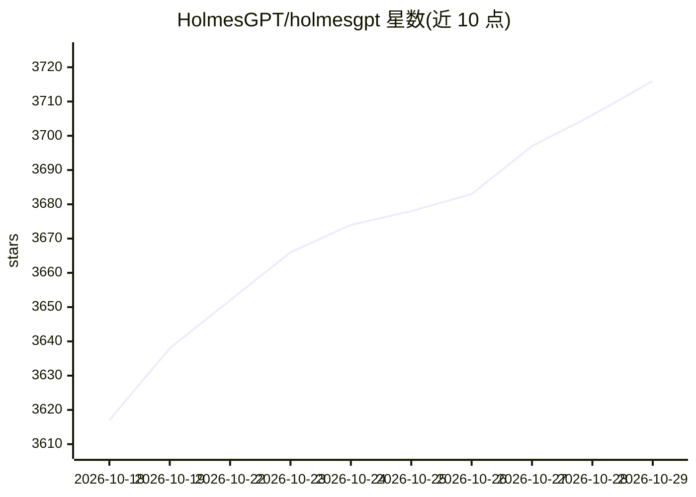

# HolmesGPT/holmesgpt

⭐ 3,716 · Python · Apache-2.0 · 推送 2026-10-28 · [GitHub](https://github.com/HolmesGPT/holmesgpt) · [官网](https://holmesgpt.dev/) · 组织维护

**开源 SRE AI Agent：调查生产事故并定位根因**

面向生产环境故障排查的 AI agent，通过 agentic loop 查询多个观测数据源识别根因。内置 40 余种数据源 toolset（Kubernetes、Prometheus、Datadog、Grafana、各云平台、数据库等），可从 AlertManager、PagerDuty、Jira 等拉取告警并把分析结果写回或发到 Slack。支持 OpenAI、Anthropic、Azure、Bedrock、Gemini 等多种 LLM 提供商。Operator 模式可在 Kubernetes 中后台持续巡检。默认只读访问并遵循 RBAC。CNCF 沙箱项目，最初由 Robusta.Dev 创建。

## 筛选速览

| 维度 | 判定 | 备注 |
|---|---|---|
| AI 角色 | `ai-native` | 本体是模型或模型工具 |
| 许可风险 | `permissive` | Apache-2.0 |
| 部署形态 | `None` |  |
| 模型依赖 | — | README 未给出锁定关系 |
| 硬件要求 | — | 无带数字的原话,不猜 |
| 安装摩擦 | `low` | 无编译、无系统依赖或容器化 |
| 成熟度 | — | 结构信号不足 |

## 能力要点

- 40+ 内置 toolset：Kubernetes、Prometheus、Datadog、Grafana、SQL 数据库、各云平台等
- 告警双向集成：从 AlertManager/PagerDuty/OpsGenie/Jira 拉取并写回分析
- 支持 OpenAI、Anthropic、Azure、Bedrock、Gemini 等多种 LLM 提供商
- Operator 模式在 Kubernetes 后台持续发现并报告问题，可通过 GitHub 集成开 PR 修复

## 适用场景

- 我需要一个能查 Kubernetes/Prometheus 告警根因的 AI 助手
- 让 AI 在 Slack 上自动分析 PagerDuty/Jira 事故工单
- 后台持续巡检服务并在客户发现前通知我

## 场景标签

 · 领域:运维/AIOps

## 证据(README 行号)

> L7: Open-source AI agent for investigating production incidents and finding root causes. Works with any stack — Kubernet
> L29: HolmesGPT uses an **agentic loop** to query live observability data from multiple sources and identify root causes.

## 星数曲线

2026-10-18 3,617 → 2026-10-29 3,716（+99）

---
*卡片 v1 · prompt 1.4 · 生成 2026-10-20 · 置信度 high · 依据 README sha `d4650920c2c9` · [字段定义](../../DATASET.md)*
