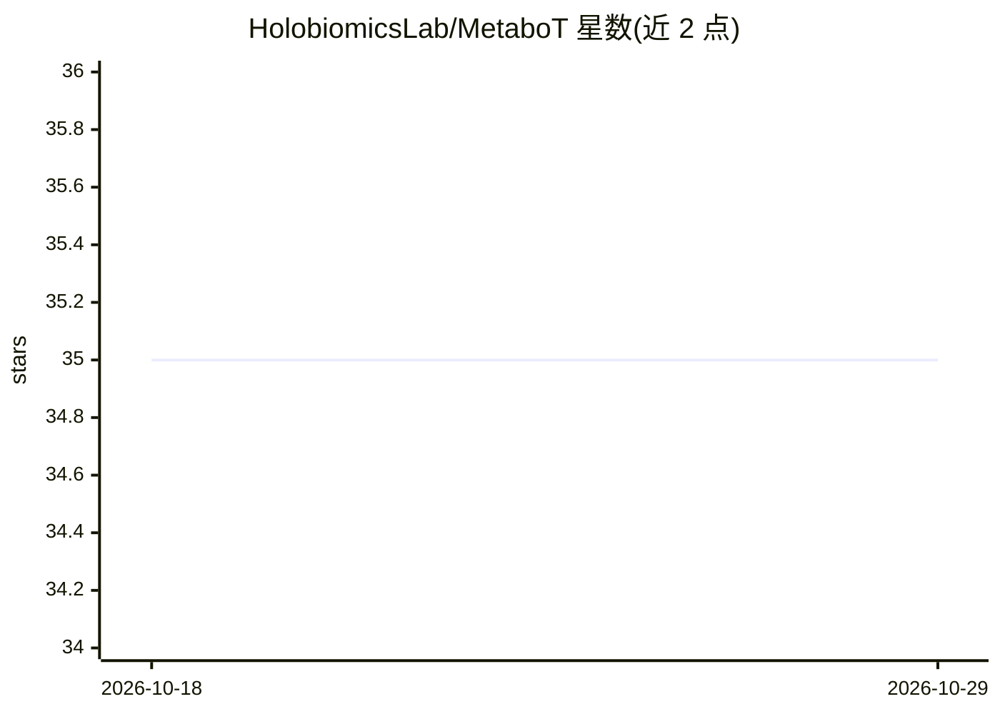

# HolobiomicsLab/MetaboT

⭐ 35 · Jupyter Notebook · Apache-2.0 · 推送 2026-05-07 · [GitHub](https://github.com/HolobiomicsLab/MetaboT) · [官网](https://holobiomicslab.github.io/MetaboT/) · 组织维护

**面向代谢组学研究者：自然语言查询质谱知识图谱的多智能体框架**

MetaboT 是开源的 LLM 多智能体框架，将自然语言代谢组学问题翻译为可在知识图谱上执行的 SPARQL 查询。工作流含六类智能体：入口分类、范围校验、调度、实体解析、SPARQL 查询执行与结果解读。实体解析依托 Wikidata、ChEMBL、NPClassifier、GNPS 等外部资源而非仅靠 LLM 记忆。默认连接公开 ENPKG 端点（1,600 种植物提取物的代谢组学知识图谱），可换成自有图谱但需调整 schema 感知提示词。提供 CLI、Streamlit 网页界面与 Docker 运行方式，需 Python 3.11 与至少一个 LLM 提供商 API key。

## 筛选速览

| 维度 | 判定 | 备注 |
|---|---|---|
| AI 角色 | `ai-native` | 本体是模型或模型工具 |
| 许可风险 | `permissive` | Apache-2.0 |
| 部署形态 | `self-host` | docker 或自建部署 |
| 模型依赖 | — | README 未给出锁定关系 |
| 硬件要求 | — | 无带数字的原话,不猜 |
| 安装摩擦 | `low` | 无编译、无系统依赖或容器化 |
| 成熟度 | — | 结构信号不足 |

## 能力要点

- 自然语言转 schema 感知 SPARQL，支持对话式迭代精炼
- 六智能体分工：校验、实体解析、查询生成、结果解读与可视化
- 实体解析基于 Wikidata/ChEMBL/NPClassifier/GNPS 等外部资源
- 支持接入自有知识图谱与自定义 SPARQL 端点

## 适用场景

- 用自然语言查询 ENPKG 质谱代谢组学知识图谱
- 将标注质谱数据构建为知识图谱后进行交互式挖掘
- 研究者避免直接编写 RDF/SPARQL 即可做语义数据挖掘

## 场景标签

`多智能体` `知识图谱` `科研工具` · 领域:Agent 开发

## 证据(README 行号)

> L32: MetaboT is an open-source multi-agent framework that translates natural-language metabolomics questions into execut
> L34: Compared with single-model prompting, MetaboT uses a workflow of specialized agents for question validation, entity

## 星数曲线

2026-10-18 35 → 2026-10-29 35（+0）

---
*卡片 v1 · prompt 1.4 · 生成 2026-10-25 · 置信度 high · 依据 README sha `f561ae022f9b` · [字段定义](../../DATASET.md)*
