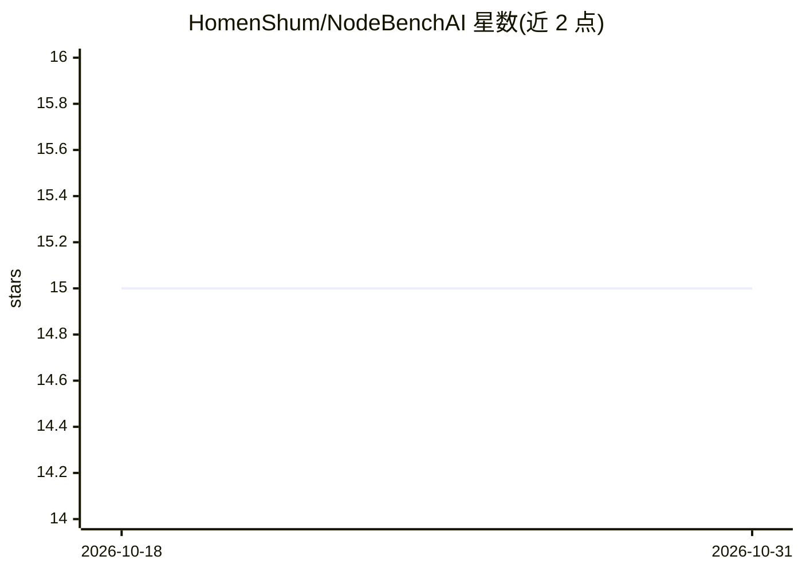

# HomenShum/NodeBenchAI

⭐ 15 · TypeScript · MIT · 推送 2026-10-23 · [GitHub](https://github.com/HomenShum/NodeBenchAI) · [官网](https://www.nodebenchai.com) · 个人维护

**面向公司/市场问题的研究综合系统，产出可复用带来源档案**

研究型报告产品：围绕 Home/Reports/Chat/Inbox/Me 五个界面与独立的深度研究 Workspace，接受问题、文件、URL 或历史线程，执行带来源的检索与综合，将每次运行转为可复用制品并跟踪后续变化。后端状态基于 Convex，提供 SSE 流式输出、实体关系图（Live Graph rail），并托管公共研究 MCP 端点（nodebench-mcp-unified.onrender.com），可被外部 agent 无需注册调用（匿名但限流），另有 npx 分发的三个 MCP 通道。README 详述一个未合并的发布候选所收紧的运行时控制与移除项，其发布证据待 PR 合并后补记。

## 筛选速览

| 维度 | 判定 | 备注 |
|---|---|---|
| AI 角色 | `ai-native` | 本体是模型或模型工具 |
| 许可风险 | `permissive` | MIT |
| 部署形态 | `library` | 以包/库形式分发 |
| 模型依赖 | — | README 未给出锁定关系 |
| 硬件要求 | — | 无带数字的原话,不猜 |
| 安装摩擦 | `low` | 无编译、无系统依赖或容器化 |
| 成熟度 | — | 结构信号不足 |

## 能力要点

- 五界面 Web 应用 + 独立深度研究 Workspace，产出带来源绑定的综合报告
- 托管公共研究 MCP 端点，外部 agent 匿名即可调用（默认匿名、限流计量）
- nodebench-mcp / -power / -admin 三个 npx 分发通道
- Convex 承载会话/报告/实体/文件等产品状态，SSE 流式输出

## 适用场景

- 对任意公司、市场或问题生成带来源与新鲜度的研究档案
- 把每次研究运行沉淀为可复用制品并持续跟踪变化
- 让外部 agent 通过公共 MCP 端点复用其研究与记忆能力

## 场景标签

`科研工具` `文档问答` · 领域:知识与检索

## 证据(README 行号)

> L51: users do not just need a chatbot that answers once.
> L56: - search and synthesize with sources

## 星数曲线

2026-10-18 15 → 2026-10-31 15（+0）

---
*卡片 v1 · prompt 1.4 · 生成 2026-10-30 · 置信度 mid · 依据 README sha `d64de2c79cb8` · [字段定义](../../DATASET.md)*
