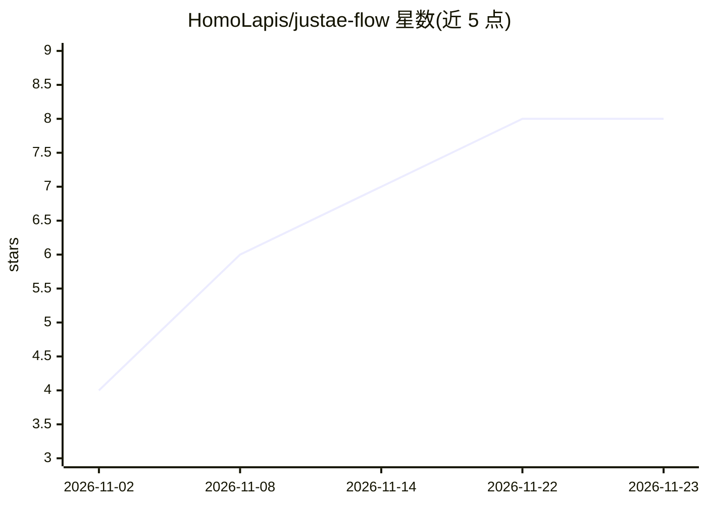

# HomoLapis/justae-flow

⭐ 8 · TypeScript · GPL-3.0 · 推送 2026-10-30 · [GitHub](https://github.com/HomoLapis/justae-flow) · [官网](https://homolapis.ai) · 组织维护

**在开源合成软件时间线内运行 ComfyUI 工作流生成视频片段**

作为 EffectCraft（开源合成软件）插件运行的面板：在时间线上用占位层或标记划出剪辑，写入提示后由 ComfyUI 生成片段并回填到对应槽位；Comp 标签页对整个合成执行改画幅、放大、抠像、延长、修复等操作，结果作为新图层进入项目并保留所用工作流与参数。服务器仅监听 127.0.0.1，可指向本地 ComfyUI、自有 Comfy API 部署或 Comfy Cloud；预设仅使用开放权重模型。依赖 Node.js 22.18+、EffectCraft 0.11.1+、ComfyUI 0.38+ 与 ffmpeg。

## 筛选速览

| 维度 | 判定 | 备注 |
|---|---|---|
| AI 角色 | `ai-native` | 本体是模型或模型工具 |
| 许可风险 | `viral` | GPL-3.0 |
| 部署形态 | `None` |  |
| 模型依赖 | local-ok | 支持本地模型 |
| 硬件要求 | — | 无带数字的原话,不猜 |
| 安装摩擦 | `medium` | 含编译或系统依赖之一 |
| 成熟度 | — | 结构信号不足 |

## 能力要点

- 将 ComfyUI 工作流读取为表单，按时间线逐镜头生成并回填片段
- Comp 级工具：Wan 2.1 VACE 改画幅、SeedVR2 放大、SAM 3/LTX Alpha 抠像、LTX-2.5 延长
- 运行位置可选：本地 ComfyUI、自有 Comfy API 部署或 Comfy Cloud
- 每个运行保存输入、输出、工作流与 job.json 于项目旁文件夹

## 适用场景

- 在时间线上批量生成占位镜头对应的视频片段
- 将 16:9 素材生成式重构为 9:16 等社交格式
- 对既有镜头做放大、去压缩、上色、昼夜转换等修复
- 在两个片段之间生成衔接镜头

## 场景标签

`视频生成` · 领域:内容生成

## 证据(README 行号)

> L18: JustAE Flow adds a window next to its timeline where ComfyUI does the
> L19: generating. You block out a cut with placeholders or markers, write what happens in each shot, press Generate, and 
> L44: own workflow. Write what happens in it, press Generate: the shots are made one after the other, with their sound, a

## 星数曲线

2026-11-02 4 → 2026-11-23 8（+4）

---
*卡片 v1 · prompt 1.4 · 生成 2026-11-20 · 置信度 high · 依据 README sha `eabca000647c` · [字段定义](../../DATASET.md)*
