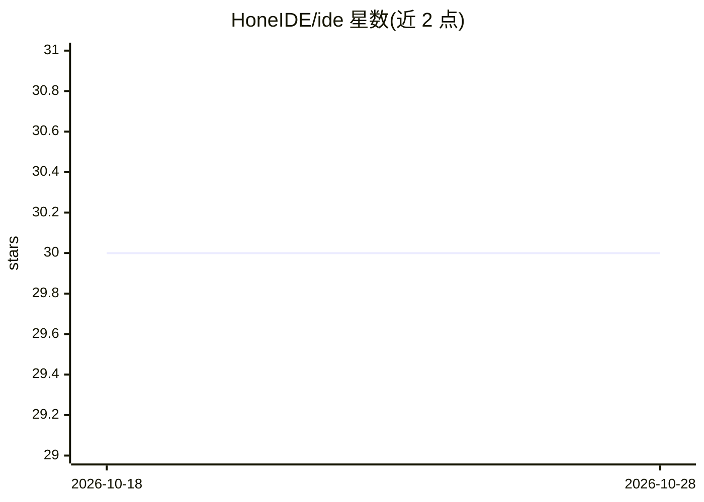

# HoneIDE/ide

⭐ 30 · TypeScript · MIT · 推送 2026-07-16 · [GitHub](https://github.com/HoneIDE/ide) · [官网](https://hone.codes) · 组织维护

**跨平台 AI 辅助代码编辑器，覆盖桌面与移动端**

以单一 TypeScript 代码库经 Perry 编译为各平台原生 UI 的 IDE，目标平台包括 macOS、Windows、Linux、iOS、iPadOS、Android 与 Web。AI 功能包括内联补全、聊天侧栏、自主 agent 模式与 AI PR 审查。基础功能含文件浏览器、Git、LSP、DAP 调试、终端与扩展系统；README 状态表显示 Slice 15（打磨与打包）尚未完成。构建依赖 Perry 编译器，iOS 设备部署需 Apple 开发者账号与签名配置。

## 筛选速览

| 维度 | 判定 | 备注 |
|---|---|---|
| AI 角色 | `ai-enhanced` | 去掉 AI 部分产品仍成立 |
| 许可风险 | `permissive` | MIT |
| 部署形态 | `desktop` | 安装包/桌面程序 |
| 模型依赖 | — | README 未给出锁定关系 |
| 硬件要求 | — | 无带数字的原话,不猜 |
| 安装摩擦 | `low` | 无编译、无系统依赖或容器化 |
| 成熟度 | — | 结构信号不足 |

## 能力要点

- 单一 TypeScript 代码库经 Perry 编译为各平台原生 UI
- AI 内联补全、聊天、agent 模式与 AI PR 审查
- 桌面/iPad/手机三种布局模式
- 内置 Git、LSP、DAP 调试与扩展系统

## 适用场景

- 在 iPad 或 Android 平板上进行完整 IDE 开发
- 桌面端进行 AI 辅助编码与 PR 审查
- 手机上进行轻量代码编辑

## 场景标签

`代码生成` `编码 Agent` `代码审查` · 领域:编码与开发

## 证据(README 行号)

> L3: AI-native code editor for all platforms — macOS, Windows, Linux, iOS, iPadOS, Android, Web.
> L16: - **AI-native** — inline completions, chat sidebar, autonomous agent mode, AI PR review

## 星数曲线

2026-10-18 30 → 2026-10-28 30（+0）

---
*卡片 v1 · prompt 1.4 · 生成 2026-10-26 · 置信度 high · 依据 README sha `540f845854dc` · [字段定义](../../DATASET.md)*
