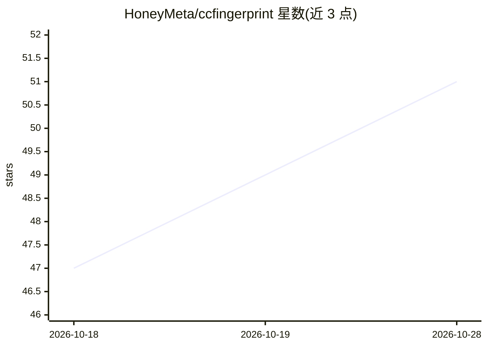

# HoneyMeta/ccfingerprint

⭐ 52 · JavaScript · MIT · 推送 2026-10-08 · [GitHub](https://github.com/HoneyMeta/ccfingerprint) · [官网](https://honeymeta.com/ccfingerprint) · 组织维护 · 中文 README

**AI 模型身份指纹鉴定工具：探针作答+本地评分检测模型偷换降智**

面向 AI 助手用户的模型身份核验工具。它向模型发起四类探针（自我声明、带日期锚点的知识边界探针、分难度能力探针、ASCII 风格签名），模型作答生成 ccfp-report.json，再由本地脚本 ccffp verify 按内置答案键离线确定性打分，输出 0-100 可信度与结论（可信/存疑/不可信）；评分过程不经过被测模型。以 npm/GitHub 安装的 Node.js CLI 提供，支持 14 款 AI 助手生成 /fingerprint 命令。题库数据集中在 dataset.json，可增补锚点无需改代码。

## 筛选速览

| 维度 | 判定 | 备注 |
|---|---|---|
| AI 角色 | `ai-ecosystem` | LLM/agent 周边工具 |
| 许可风险 | `permissive` | MIT |
| 部署形态 | `library` | 以包/库形式分发 |
| 模型依赖 | — | README 未给出锁定关系 |
| 硬件要求 | — | 无带数字的原话,不猜 |
| 安装摩擦 | `low` | 无编译、无系统依赖或容器化 |
| 成熟度 | — | 结构信号不足 |

## 能力要点

- 四类探针：自我声明、知识边界、分难度能力探针、风格指纹
- 本地确定性评分，答案键不出现在模型提示词中，可检测联网作弊与编造
- 支持 Claude Code/Codex/Cursor/Copilot 等 14 款助手，生成按需调用的命令
- v2.3 修正身份核验逻辑：检查自称模型是否知道其官方知识截止前的事件

## 适用场景

- 怀疑服务商偷换或降级模型时做身份鉴定
- 在 Claude Code/Cursor 等助手里一键运行 /fingerprint 核验
- 对比模型自我声明与实际知识边界，发现冒牌或降智

## 场景标签

`模型评测` · 领域:评测与运维

## 证据(README 行号)

> L97: ccfp init  →  /fingerprint  ┌─ 模型作答 → ccfp-report.json → 模型自己跑 ccfp verify ─┐ →  鉴定结论
> L108: `ccfp verify` 离线读取报告，按内置答案键确定性打分，推断真实知识截止、计算能力通过率，核对"自称身份"与"表现出的知识"是否一致，最后给出 0–100 可信度评分与结论（可信 / 存疑 / 不可信）。**整个评分过
> L105: 3. **能力探针（降智检测）**：分难度等级、答案唯一可校验的题（计数、严格指令遵循、带干扰项的 needle 召回、代码追踪、日历推算、逻辑推理、数论）。通过率过低 = 疑似被换成更弱的模型。

## 星数曲线

2026-10-18 47 → 2026-10-28 51（+4）

---
*卡片 v1 · prompt 1.4 · 生成 2026-10-25 · 置信度 high · 依据 README sha `ba880abe3f1e` · [字段定义](../../DATASET.md)*
