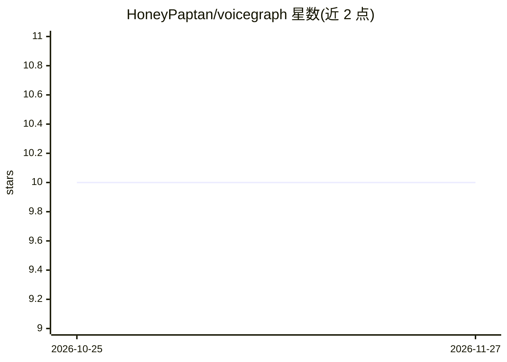

# HoneyPaptan/voicegraph

⭐ 10 · TypeScript · 推送 2026-01-07 · [GitHub](https://github.com/HoneyPaptan/voicegraph) · [官网](https://voicegraph.vercel.app) · 个人维护

**语音输入生成可视化自动化工作流并跨服务执行的平台**

基于 Next.js 的 Web 平台：用户以语音或文字描述自动化需求，经 Groq Whisper 转录为文本，再由 Cerebras LLM（qwen-3-32b）解析生成工作流 JSON，通过 React Flow 呈现为可编辑的可视化图，随后调用 Notion、Tavily、Email（SMTP）、GitHub 等服务 API 执行，支持实时与后台两种执行模式及完整执行历史。README 标明该项目为 hackathon 竞赛作品，Cerebras 为赞助商必备集成，需自备 API Key 才能运行。

## 筛选速览

| 维度 | 判定 | 备注 |
|---|---|---|
| AI 角色 | `ai-native` | 本体是模型或模型工具 |
| 许可风险 | `none` | — |
| 部署形态 | `None` |  |
| 模型依赖 | — | README 未给出锁定关系 |
| 硬件要求 | — | 无带数字的原话,不猜 |
| 安装摩擦 | `low` | 无编译、无系统依赖或容器化 |
| 成熟度 | — | 结构信号不足 |

## 能力要点

- 语音→Whisper 转录→LLM 解析→可视化工作流的完整链路
- React Flow 拖拽编辑与实时节点状态高亮
- 异步后台执行与执行历史审计
- 内置 Notion/Email 摘要、网络调研等预置工作流示例

## 适用场景

- 语音说一句话即可生成 Notion 笔记转邮件摘要的自动化流程
- 让 AI 搜索资料并整理成 Notion 页面
- 定时多步任务：搜集热点、汇总并发送日报邮件

## 场景标签

`工作流自动化` · 领域:效率与自动化

## 证据(README 行号)

> L5: Transform your voice commands into automated workflows with visual graph interface. VoiceGraph uses advanced AI to p
> L37: 1. **Voice Input** → Groq Whisper → Text
> L38: 2. **Text** → Cerebras LLM → Workflow JSON

## 星数曲线

2026-10-25 10 → 2026-11-27 10（+0）

---
*卡片 v1 · prompt 1.4 · 生成 2026-11-20 · 置信度 high · 依据 README sha `ac810eed5761` · [字段定义](../../DATASET.md)*
