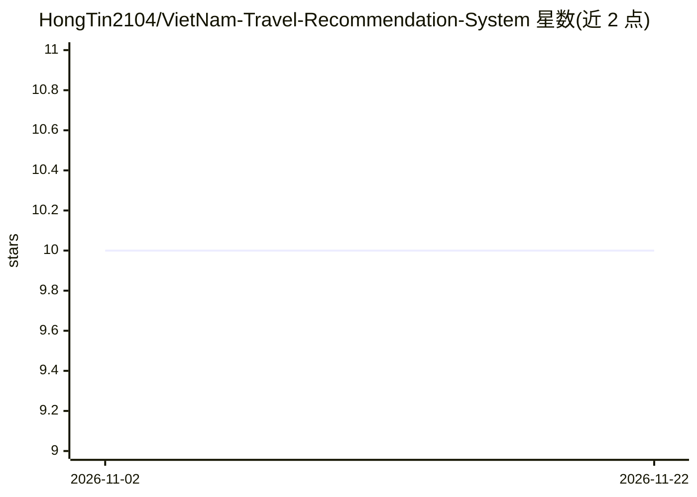

# HongTin2104/VietNam-Travel-Recommendation-System

⭐ 10 · Python · MIT · 推送 2026-11-19 · [GitHub](https://github.com/HongTin2104/VietNam-Travel-Recommendation-System) · [官网](https://vietnam-travel-recsys.streamlit.app/) · 个人维护 · 中文 README

**用自然语言描述匹配越南旅游目的地的推荐应用**

基于自建数据集（315 个地点，覆盖 2025 年 7 月后越南 34 个新省级单位）的内容型推荐系统：用户以越南语或英语描述想要的旅行方式，系统经 underthesea 分词、保留复合词语音节、TF-IDF（unigram+bigram）与余弦相似度对地点描述排序，并附省级过滤。提供 Streamlit 在线演示与本地/Docker 运行方式；评估以数据集自身关键词标签构造 46 个查询，与随机及多个基线比较 P@3/R@10/MRR。README 说明标注受词面重叠偏置、样本非完整指南等限制。

## 筛选速览

| 维度 | 判定 | 备注 |
|---|---|---|
| AI 角色 | `ai-native` | 本体是模型或模型工具 |
| 许可风险 | `permissive` | MIT |
| 部署形态 | `self-host` | docker 或自建部署 |
| 模型依赖 | — | README 未给出锁定关系 |
| 硬件要求 | — | 无带数字的原话,不猜 |
| 安装摩擦 | `low` | 无编译、无系统依赖或容器化 |
| 成熟度 | — | 结构信号不足 |

## 能力要点

- 315 个手工收集地点，按 63 旧省映射至 34 新省（Resolution 202/2025/QH15）
- underthesea 分词并保留复合词语音节，缓解音节查询失配
- 可复现的定量评估脚本 scripts/evaluate.py，含多个基线对比
- MIT（代码）+ CC BY 4.0（数据）双部分许可

## 适用场景

- 用越南语或英语描述旅行偏好，获取匹配的越南目的地
- 作为数据挖掘/NLP/推荐系统课程的参考项目
- 复用新旧省份映射表做其他项目

## 场景标签

`推荐系统` · 领域:学习与行业

## 证据(README 行号)

> L10: Describe the trip you want in Vietnamese or English and get matching destinations from a hand-built dataset of
> L50: segmented words. TF-IDF over unigrams and bigrams is then compared to the query with cosine similarity.
> L57: There are no human relevance judgements yet, so the evaluation uses the dataset's own keyword tags as labels: each

## 星数曲线

2026-11-02 10 → 2026-11-22 10（+0）

---
*卡片 v1 · prompt 1.4 · 生成 2026-11-20 · 置信度 high · 依据 README sha `5462a61e201f` · [字段定义](../../DATASET.md)*
