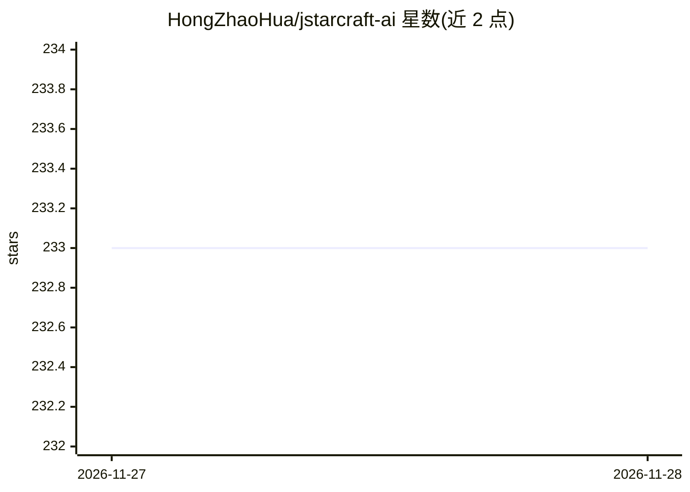

# HongZhaoHua/jstarcraft-ai

⭐ 233 · Java · Apache-2.0 · 推送 2026-11-26 · [GitHub](https://github.com/HongZhaoHua/jstarcraft-ai) · 个人维护 · 中文 README

**Java 机器学习框架，连接学术界与工业界的研发人员**

基于 Java 的机器学习工具包，由数据结构、算法和模型组成，覆盖数据处理、训练与评估环节。包含线性、近邻、神经网络、概率图、规则、SVM、树等模型，以及梯度下降、遗传算法等优化方法；环境支持串行/并行与 CPU/GPU 计算（基于 ND4J）。通过 Maven/Gradle 引入，数据转换器支持 ARFF/CSV/JSON/HQL/SQL 格式，提供 AUC、NDCG、MSE 等评估指标。遵循 Apache 2.0 协议。

## 筛选速览

| 维度 | 判定 | 备注 |
|---|---|---|
| AI 角色 | `ai-native` | 本体是模型或模型工具 |
| 许可风险 | `permissive` | Apache-2.0 |
| 部署形态 | `None` |  |
| 模型依赖 | — | README 未给出锁定关系 |
| 硬件要求 | — | 无带数字的原话,不猜 |
| 安装摩擦 | `medium` | 含编译或系统依赖之一 |
| 成熟度 | — | 结构信号不足 |

## 能力要点

- 涵盖线性、神经网络、概率图、SVM、树等多类模型与梯度下降、遗传算法等优化方法
- 支持串行/并行与 CPU/GPU 计算环境（ND4J 后端）
- 数据转换器支持 ARFF/CSV/JSON/HQL/SQL 格式
- 提供 AUC、MAP、NDCG、MAE、MSE 等排序与评分评估指标

## 适用场景

- 在 Java 项目中训练和评估分类、回归、聚类模型
- 学术研究中的算法原型迁移到 Java 工业环境
- 读取 CSV/ARFF 等格式数据并做选择、排序、切割处理

## 场景标签

`模型训练` `模型评测` · 领域:评测与运维

## 证据(README 行号)

> L15: JStarCraft AI是一个基于Java语言的机器学习工具包,由一系列的数据结构,算法和模型组成.
> L57: * 5.模型(model)
> L83: * 7.有监督学习(supervised)

## 星数曲线

2026-11-27 233 → 2026-11-28 233（+0）

---
*卡片 v1 · prompt 1.4 · 生成 2026-11-27 · 置信度 high · 依据 README sha `3a0c7a51058c` · [字段定义](../../DATASET.md)*
