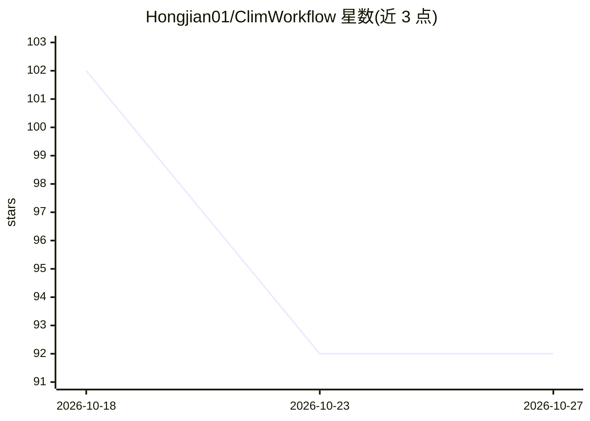

# Hongjian01/ClimWorkflow

⭐ 92 · Python · NOASSERTION · 推送 2026-09-18 · [GitHub](https://github.com/Hongjian01/ClimWorkflow) · 个人维护 · 中文 README

**可恢复气候数据智能体：自然语言驱动获取/检查/绘图/报告**

基于 OpenHarness 框架（fork）的气候数据分析智能体：模型决定调用哪个工具，通过 8 个 climate_* 工具执行 init→plan→acquire→inspect→plot→report 的硬顺序流水线。关键机制：进度写入 .climate/ 磁盘而非聊天，中断后经 climate_read_context 续跑；计划须用户确认才允许下载；工具失败返回结构化错误码。CDS 数据获取仅限 ERA5 静态清单（有界重试、超时处理）；NetCDF/绘图在子进程执行。面向科研/开发者，需 Python≥3.10 与 uv，离线 Demo 无需 API Key。限制：不是通用 DAG 调度器，未合入上游 HKUDS。

## 筛选速览

| 维度 | 判定 | 备注 |
|---|---|---|
| AI 角色 | `ai-native` | 本体是模型或模型工具 |
| 许可风险 | `none` | NOASSERTION |
| 部署形态 | `None` |  |
| 模型依赖 | — | README 未给出锁定关系 |
| 硬件要求 | — | 无带数字的原话,不猜 |
| 安装摩擦 | `low` | 无编译、无系统依赖或容器化 |
| 成熟度 | — | 结构信号不足 |

## 能力要点

- 进度落盘磁盘、中断后 climate_read_context 续跑，不依赖聊天记录
- 计划确认闸门与硬顺序门禁，未确认不允许下载数据
- 8 个 climate_* 工具，每个带 Pydantic 入参、JSON Schema 与统一错误码
- CDS 获取限定 ERA5 静态清单，带重试/超时/.part 稳定发布机制

## 适用场景

- 用自然语言让智能体完成 ERA5 数据获取到报告的完整分析链路
- 长任务中断后从磁盘上下文恢复，不从头重跑
- 在门禁约束下生成含图与 Markdown 报告的气候分析产物

## 场景标签

`数据分析` · 领域:效率与自动化

## 证据(README 行号)

> L5:  基于 OpenHarness 的可恢复气候数据智能体
> L6:  自然语言 → 获取 / 检查 / 绘图 / 报告
> L83: init → plan → （用户确认）→ acquire → inspect → plot → report → validate

## 星数曲线

2026-10-18 102 → 2026-10-27 92（-10）

---
*卡片 v1 · prompt 1.4 · 生成 2026-10-23 · 置信度 high · 依据 README sha `cdb5b4709356` · [字段定义](../../DATASET.md)*
