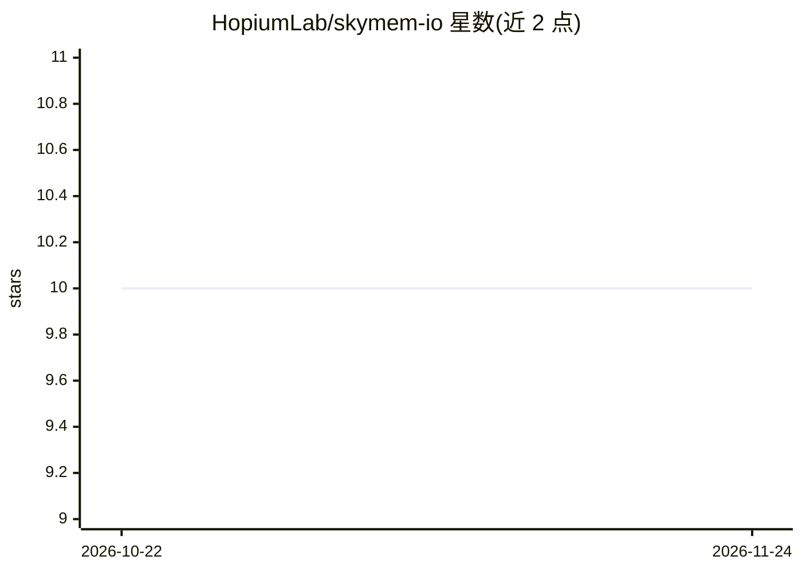

# HopiumLab/skymem-io

⭐ 10 · JavaScript · NOASSERTION · 推送 2026-06-12 · [GitHub](https://github.com/HopiumLab/skymem-io) · [官网](https://skymem.io) · 组织维护

**为持久化 AI agent 提供可审计记忆与结构化认知层**

面向 AI 工程团队的 agent 记忆系统：以时间知识图谱存储节点、分域事实、轨迹与溯源，agent 每轮查询替代平铺 markdown，缓解多会话间的记忆漂移与自相矛盾。提供 13 层认知栈、8 个可观测性原语与 17 个工具的 MCP server，兼容 Claude Code、Cursor 等客户端。以 Docker compose 自托管运行，自带 LLM 密钥（Anthropic + Cohere），数据留本地，Elastic License v2 许可。README 自述 LOCOMO 得分 70.75%，低于部分竞品。

## 筛选速览

| 维度 | 判定 | 备注 |
|---|---|---|
| AI 角色 | `ai-ecosystem` | LLM/agent 周边工具 |
| 许可风险 | `none` | NOASSERTION |
| 部署形态 | `self-host` | docker 或自建部署 |
| 模型依赖 | locked-api |  |
| 硬件要求 | — | 无带数字的原话,不猜 |
| 安装摩擦 | `low` | 无编译、无系统依赖或容器化 |
| 成熟度 | `idea` | |

## 能力要点

- 17 工具的 MCP server（8 认知 + 9 可观测），兼容主流 MCP 客户端
- 8 个审计级可观测原语：provenance_tree、decision_lineage、fact_trajectory、audit_log 等
- 7 个认知域结构化事实与 4 种答案形态模式（literal/list/temporal/multi-hop）
- 双时间有效性窗口、矛盾检测与被取代事实保留，Docker compose 自托管

## 适用场景

- 为 Claude Code/Cursor 等编码 agent 提供跨会话持久记忆
- 受监管行业需要回答溯源与审计日志的 AI 系统
- 排查 agent 为何给出某答案（explain_retrieval/decision_lineage）

## 场景标签

`Agent 记忆` `知识图谱` · 领域:Agent 开发

## 证据(README 行号)

> L3: **The trusted state layer for persistent AI agents.**
> L7: Built for AI engineering teams first (Claude Code · Cursor · agentic frameworks). Same engine extends to teams, vert
> L137: Drop-in for any MCP-compatible client (Claude Code, Cursor, Windsurf, Devin, Zed). 8 cognition tools + 9 observabi

## 星数曲线

2026-10-22 10 → 2026-11-24 10（+0）

---
*卡片 v1 · prompt 1.4 · 生成 2026-11-20 · 置信度 mid · 依据 README sha `770b8d516a99` · [字段定义](../../DATASET.md)*
