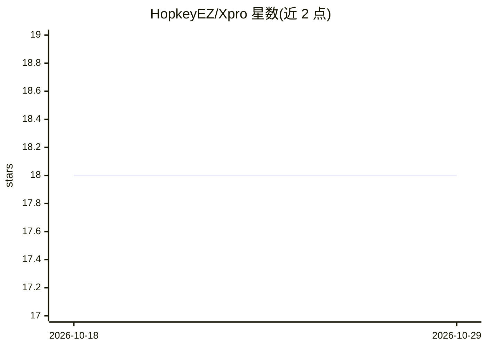

# HopkeyEZ/Xpro

⭐ 18 · TypeScript · MIT · 推送 2026-09-10 · [GitHub](https://github.com/HopkeyEZ/Xpro) · 个人维护 · 中文 README

**带内置评测的多智能体进程：以 git diff 重复打分验证 agent 可靠性**

可从 shell、容器或 CI 启动的多智能体进程，接收任务后用真实工具（读写/搜索/命令/MCP）在目录上执行直至完成；同一内核附带评测层：每个 prompt 从干净 commit 独立重复跑 N 次，评分器只看产出的 git diff 而非 agent 自述，输出均值与方差报告。支持 OpenAI 与 Anthropic 协议，全配置走环境变量，可作 HTTP 服务（SSE）或 SDK（createAgent/defineTool）嵌入；打分器与工作区可替换（如 npm test 退出码、容器/VM）。附可选 Electron IDE 前端，运行时进程仅需 Node 18+。

## 筛选速览

| 维度 | 判定 | 备注 |
|---|---|---|
| AI 角色 | `ai-ecosystem` | LLM/agent 周边工具 |
| 许可风险 | `permissive` | MIT |
| 部署形态 | `library` | 以包/库形式分发 |
| 模型依赖 | — | README 未给出锁定关系 |
| 硬件要求 | — | 无带数字的原话,不猜 |
| 安装摩擦 | `low` | 无编译、无系统依赖或容器化 |
| 成熟度 | — | 结构信号不足 |

## 能力要点

- 三种运行形态：xpro run / serve（HTTP+SSE）/ eval（N 次重复 rollout 打分）
- 凭 git diff 打分、不读 agent 自述，报告含 mean+stddev 可靠性指标
- 六层架构，工具注册与权限策略解耦，支持子 agent 隔离与跨会话记忆
- SDK 零依赖（仅全局 fetch），Workspace 与 Scorer 均可替换（llmJudge/npm test/lint 差值）

## 适用场景

- 在 CI 里无头运行编码 agent 并以退出码判断完成情况
- 重复评测 coding agent，用方差判断其可靠性后再接入业务
- 作为 SDK 把自己的业务工具接入同一套 agent 循环与评测体系

## 场景标签

`Agent 框架` `多智能体` `编码 Agent` `模型评测` · 领域:Agent 开发

## 证据(README 行号)

> L3: A **runnable multi-agent process** with a built-in **evaluation system**.
> L58: ## The evaluation system
> L88: The scoring loop is swappable: `llmJudge` is the default, but `Scorer` is a plain function, so a suite can score on
> L113: The core has no dependencies beyond global `fetch`, so it drops into any service:

## 星数曲线

2026-10-18 18 → 2026-10-29 18（+0）

---
*卡片 v1 · prompt 1.4 · 生成 2026-10-29 · 置信度 high · 依据 README sha `0094fc66cc90` · [字段定义](../../DATASET.md)*
