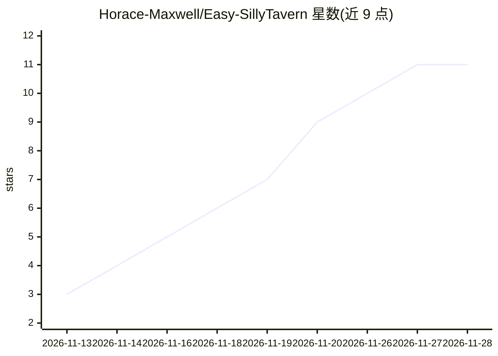

# Horace-Maxwell/Easy-SillyTavern

⭐ 11 · PowerShell · MIT · 推送 2026-11-12 · [GitHub](https://github.com/Horace-Maxwell/Easy-SillyTavern) · 个人维护 · 中文 README

**给非技术用户的 SillyTavern 一键安装与维护工具**

面向从没装过软件、不会命令行的用户的 SillyTavern（酒馆）安装器，覆盖 macOS、Windows、Linux、Android（Termux）。安装一行命令完成，自备私有 Node.js，不需要 Git/Homebrew/管理员密码；自动测速选 npmmirror/jsDelivr 镜像、识别系统代理。工具箱提供启动、更新（先自动备份）、备份/恢复、导入旧聊天记录、回滚版本、诊断报告、卸载等功能。本仓库为非官方项目，酒馆本体从 npm 官方包下载（AGPL-3.0）。

## 筛选速览

| 维度 | 判定 | 备注 |
|---|---|---|
| AI 角色 | `ai-ecosystem` | LLM/agent 周边工具 |
| 许可风险 | `permissive` | MIT |
| 部署形态 | `desktop` | 安装包/桌面程序 |
| 模型依赖 | — | README 未给出锁定关系 |
| 硬件要求 | — | 无带数字的原话,不猜 |
| 安装摩擦 | `low` | 无编译、无系统依赖或容器化 |
| 成熟度 | — | 结构信号不足 |

## 能力要点

- 一行命令安装，自带私有 Node.js，无需 Git/Node.js/管理员密码
- 自动测速选择镜像源（npmmirror/jsDelivr）并识别系统代理
- 更新前自动备份，支持一键回滚上一版本
- 工具箱含备份/恢复、旧聊天记录导入、诊断报告生成

## 适用场景

- 在 Mac/Windows 上一键装好酒馆并管理更新与备份
- 把旧酒馆的聊天记录迁移到新电脑
- 国内网络环境下自动选镜像加速安装

## 场景标签

`聊天机器人` · 领域:对话与助手

## 证据(README 行号)

> L10: **给从没装过软件、不会用命令行的人准备的 SillyTavern（酒馆） 安装器。 复制一行字、按一下回车，剩下的它自己看着办。**
> L223: - 酒馆从 npm 上的官方 `sillytavern` 包下载（npmjs 或 npmmirror，用 `dist.integrity` 校验），再从 GitHub 拿同版本的 `package-lock.json` 跑 `n

## 星数曲线

2026-11-13 3 → 2026-11-28 11（+8）

---
*卡片 v1 · prompt 1.4 · 生成 2026-11-20 · 置信度 high · 依据 README sha `0f4c346e17c3` · [字段定义](../../DATASET.md)*
