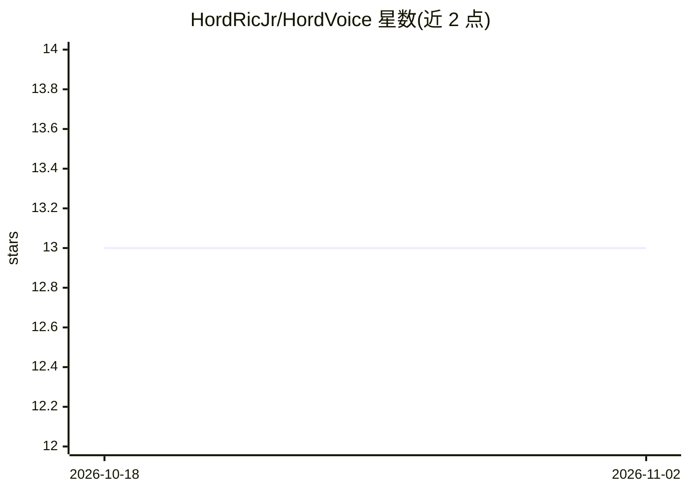

# HordRicJr/HordVoice

⭐ 13 · Dart · NOASSERTION · 推送 2025-12-15 · [GitHub](https://github.com/HordRicJr/HordVoice) · 个人维护

**Flutter 语音助手应用：Azure AI 驱动语音识别与对话**

基于 Flutter 的移动端语音助手，接入 Azure Speech 做语音识别、唤醒词检测与语音合成，Azure OpenAI（可选）提供对话与内容生成，Google ML Kit 做设备端面部情绪检测。功能包括应用间语音控制、Spotify 控制、日历管理、天气与新闻语音播报、3D 化身界面、多语言切换与本地 Supabase 语音目录。面向终端用户，通过 Google Play 或 APK 分发；开发者需 Flutter 3.32+ 与 Azure 账户自行构建配置。

## 筛选速览

| 维度 | 判定 | 备注 |
|---|---|---|
| AI 角色 | `ai-native` | 本体是模型或模型工具 |
| 许可风险 | `permissive` | NOASSERTION |
| 部署形态 | `None` |  |
| 模型依赖 | locked-api |  |
| 硬件要求 | — | 无带数字的原话,不猜 |
| 安装摩擦 | `low` | 无编译、无系统依赖或容器化 |
| 成熟度 | — | 结构信号不足 |

## 能力要点

- Azure Speech 语音识别/合成与唤醒词检测
- Azure OpenAI（可选）GPT-4 对话与上下文记忆
- 语音控制应用、Spotify、日历与系统设置
- Supabase 语音目录迁移脚本与 RLS 策略

## 适用场景

- 用语音命令控制手机应用和系统设置
- 通过对话获取天气、新闻与日程管理
- 免手操作的多语言语音交互

## 场景标签

`语音 Agent` · 领域:对话与助手

## 证据(README 行号)

> L29: HordVoice is a cutting-edge voice assistant built with Flutter, powered by Azure AI services for advanced speech re
> L53: ### 🎤 **Azure AI Voice Engine**
> L55: - **Azure OpenAI Integration**: GPT-4 powered conversational AI with persistent memory

## 星数曲线

2026-10-18 13 → 2026-11-02 13（+0）

---
*卡片 v1 · prompt 1.4 · 生成 2026-10-31 · 置信度 high · 依据 README sha `6925c9754afc` · [字段定义](../../DATASET.md)*
