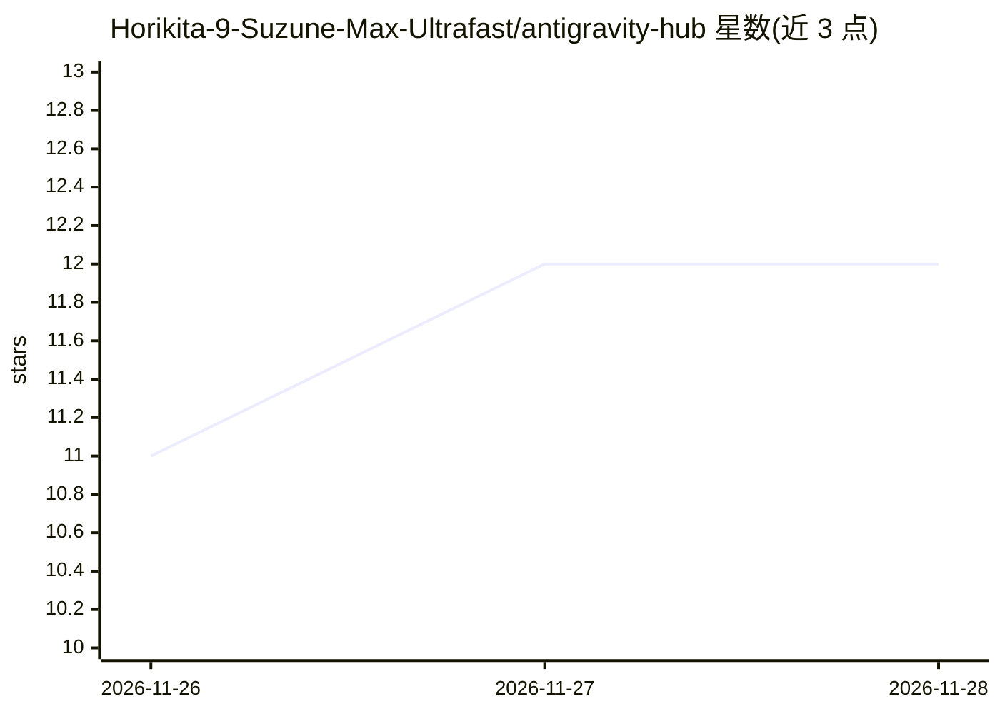

# Horikita-9-Suzune-Max-Ultrafast/antigravity-hub

⭐ 12 · JavaScript · MIT · 推送 2026-11-27 · [GitHub](https://github.com/Horikita-9-Suzune-Max-Ultrafast/antigravity-hub) · 个人维护 · 中文 README

**Google Antigravity 的零依赖 MCP 控制中心：监控上下文与治理生态**

以 Antigravity 插件（MCP App）形式安装的控制中心，含五个模块：上下文构成透视与跨会话累计用量统计（本地 SQLite，含费用估算）、本地代码审查（Git Diff 解析与静态预检）、生态治理与场景预设（插件/MCP/Skills 健康评分与快照回滚）、本地壁纸引擎、ASAR 界面汉化（739+ 词条与防降级护栏）。运行时零第三方依赖，需 Node.js >= 24；提供 Release 插件包解压部署与源码克隆两种方式；Windows 悬浮窗基于 WebView2，非 Windows 降级至浏览器 --app。

## 筛选速览

| 维度 | 判定 | 备注 |
|---|---|---|
| AI 角色 | `ai-ecosystem` | LLM/agent 周边工具 |
| 许可风险 | `permissive` | MIT |
| 部署形态 | `desktop` | 安装包/桌面程序 |
| 模型依赖 | — | README 未给出锁定关系 |
| 硬件要求 | — | 无带数字的原话,不猜 |
| 安装摩擦 | `medium` | 含编译或系统依赖之一 |
| 成熟度 | — | 结构信号不足 |

## 能力要点

- 上下文 6 维构成透视与跨会话 Token/费用统计看板（¥/$ 切换）
- 生态治理 4 支柱健康评分、场景预设与不可变快照回滚
- 纯 Node.js 流式 ASAR 补丁汉化引擎，739+ 词条热加载
- 监控与面板交互声明 0 模型 Token 消耗，零 node_modules

## 适用场景

- 查看 Antigravity 对话的上下文占用、缓存命中率与累计费用
- 提交前对新增代码做本地安全与质量预检
- 一键切换插件/MCP 场景预设并回滚配置
- 将 Antigravity 界面汉化并在升级后无损还原

## 场景标签

`代码审查` · 领域:编码与开发

## 证据(README 行号)

> L5: **专为 Google Antigravity 打造的模块化原生控制中心（MCP App）：集上下文监控与累计用量统计、本地代码审查、生态治理与场景预设、本地壁纸引擎、零依赖界面汉化于一体**
> L25: |**1. 上下文监控与记忆库** `Context Cache & Monitor`|对话变慢、缓存莫名击穿、上下文被什么占满看不清、跨会话累计消耗没总账|上下文 6 维构成透视、**跨会话累计用量统计看板（今日/24h/7d/
> L147: ### 6. 生态治理与场景预设（Ecosystem & Harness Governance）

## 星数曲线

2026-11-26 11 → 2026-11-28 12（+1）

---
*卡片 v1 · prompt 1.4 · 生成 2026-11-26 · 置信度 mid · 依据 README sha `9966fc923e28` · [字段定义](../../DATASET.md)*
