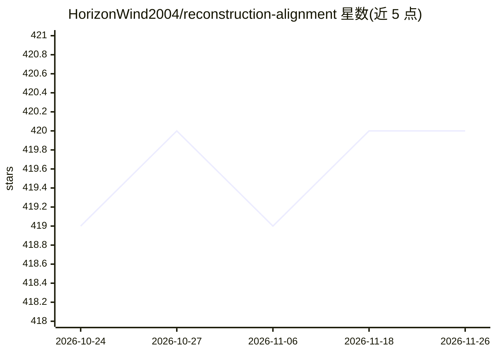

# HorizonWind2004/reconstruction-alignment

⭐ 420 · Python · Apache-2.0 · 推送 2026-11-20 · [GitHub](https://github.com/HorizonWind2004/reconstruction-alignment) · [官网](https://reconstruction-alignment.github.io/) · 组织维护 · 中文 README

**统一多模态模型的自监督后训练方法与训练代码（ICLR 2026）**

RecA 是针对预训练统一多模态模型（UMMs）的自监督后训练方法：让模型从自身视觉理解特征重建原图，该语义重建目标迁移到文生图与图像编辑，并保留原推理接口。仓库提供 BAGEL/Harmon/Show-o/OpenUni/MMaDA 等架构上的训练与评估代码、Hugging Face 模型权重（含 NF4/INT8 量化版本）、HF 在线 Demo 与 ComfyUI 使用指南，另附复现指南的英文与中文版。训练在 6×80GB A100 上约 4.5 小时完成 BAGEL 微调。

## 筛选速览

| 维度 | 判定 | 备注 |
|---|---|---|
| AI 角色 | `ai-native` | 本体是模型或模型工具 |
| 许可风险 | `permissive` | Apache-2.0 |
| 部署形态 | `None` |  |
| 模型依赖 | — | README 未给出锁定关系 |
| 硬件要求 | — | 无带数字的原话,不猜 |
| 安装摩擦 | `low` | 无编译、无系统依赖或容器化 |
| 成熟度 | — | 结构信号不足 |

## 能力要点

- 自监督重建目标，无需图文对标注数据
- 在 7 种架构上验证：Z-Image、Janus、Show-o、MMaDA、Harmon、OpenUni、BAGEL
- 提供多架构训练/评估代码与 HF 模型权重（NF4/INT8/DF11 量化版本）
- 支持 ComfyUI 中替换 BAGEL 权重使用，并提供 HF Spaces 在线 Demo

## 适用场景

- 给自己的统一多模态模型做后训练以改进生成与编辑
- 复现论文中多架构的训练与基准评估
- 在 ComfyUI 中用微调后的 BAGEL-RecA 权重做图像生成/编辑
- 在线试用 BAGEL-RecA 的生成与编辑效果

## 场景标签

`图像生成` `多模态` `微调` · 领域:内容生成

## 证据(README 行号)

> L25: **Improving image generation through visual understanding.** Reconstruction Alignment (RecA) is a **self-supervised
> L61: 4. Full Training & Evaluation: For detailed instructions on installation, training, and evaluation, please refer to
> L8:  🚀 6 × 80GB A100s × 4.5 hours to improve BAGEL on the reported generation and editing benchmarks. See the results an

## 星数曲线

2026-10-24 419 → 2026-11-26 420（+1）

---
*卡片 v1 · prompt 1.4 · 生成 2026-11-25 · 置信度 high · 依据 README sha `dae7ecb619a1` · [字段定义](../../DATASET.md)*
