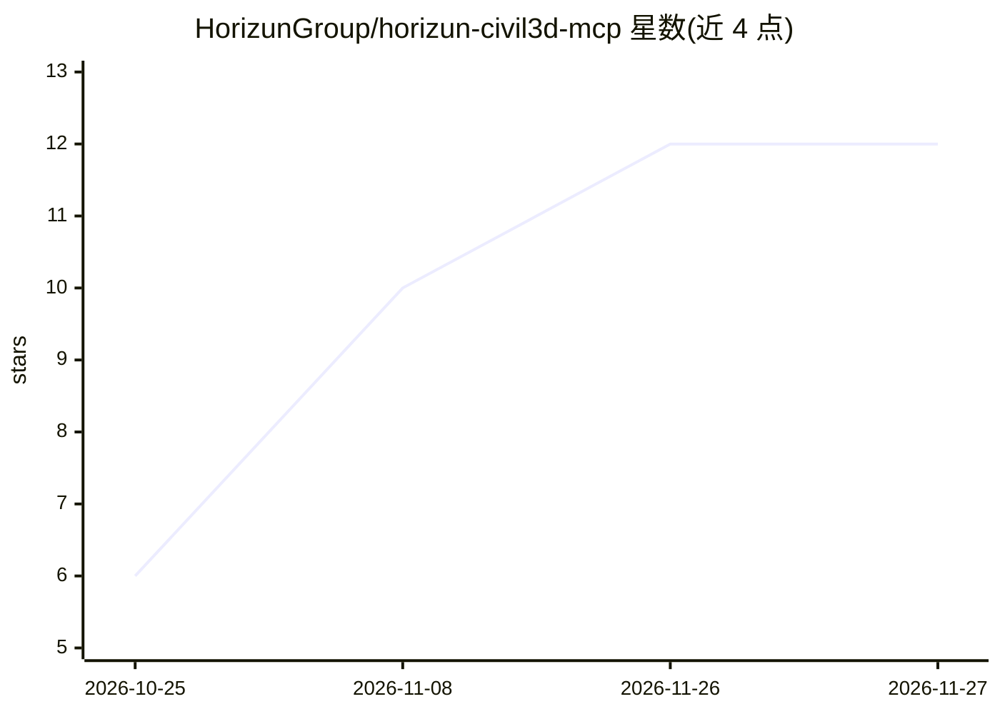

# HorizunGroup/horizun-civil3d-mcp

⭐ 12 · C# · Apache-2.0 · 推送 2026-11-03 · [GitHub](https://github.com/HorizunGroup/horizun-civil3d-mcp) · [官网](https://horizunhub.com) · 组织维护

**让 Claude 等 MCP 客户端安全操作 Autodesk Civil 3D 图形的桥接服务器**

一个 MCP 服务器，将 Codex/Claude 等 MCP 客户端连接到运行中的 Autodesk Civil 3D，提供 28 个工具、163 个声明动作，覆盖查询、放坡、路线、纵断面、管网、表格、导出等操作。写入默认 dry run 并返回一次性 confirmation_token，提交后在事务中重读图形验证结果；请求经 FIFO 队列串行执行，仅使用本地命名管道通信。提供 read_only/safe_write/full_write/unsafe_code 四级权限配置，用户侧以 zip 发行，无需在机器上编译。

## 筛选速览

| 维度 | 判定 | 备注 |
|---|---|---|
| AI 角色 | `ai-ecosystem` | LLM/agent 周边工具 |
| 许可风险 | `permissive` | Apache-2.0 |
| 部署形态 | `desktop` | 安装包/桌面程序 |
| 模型依赖 | locked-api |  |
| 硬件要求 | — | 无带数字的原话,不猜 |
| 安装摩擦 | `medium` | 含编译或系统依赖之一 |
| 成熟度 | — | 结构信号不足 |

## 能力要点

- 28 个工具、163 个动作，读写覆盖 Civil 3D 的路线、纵断面、廊道、管网、表格等对象
- 写入默认 dry run，返回绑定图形与请求的 confirmation_token，提交后重读验证
- 四级权限配置（read_only/safe_write/full_write/unsafe_code），解析失败时回退为 read_only
- 在 Civil 3D 2025 固定测试图形上完成 284/284 活体验证

## 适用场景

- 用自然语言指令让 AI 代理在 Civil 3D 中创建与修改设计对象
- 在签署前让 AI 代理生成报告并复核其交付内容
- 导出地形到 Revit 的 LandXML/OBJ 互操作流程

## 场景标签

`AI 助手` · 领域:对话与助手

## 证据(README 行号)

> L3: The bridge between Codex, Claude (or any MCP client) and a running **Autodesk Civil 3D**, by Horizun Group.
> L34: ## Tools (v0.9.7, 28 tools and 163 declared actions)

## 星数曲线

2026-10-25 6 → 2026-11-27 12（+6）

---
*卡片 v1 · prompt 1.4 · 生成 2026-11-20 · 置信度 high · 依据 README sha `a66d87a8cedb` · [字段定义](../../DATASET.md)*
