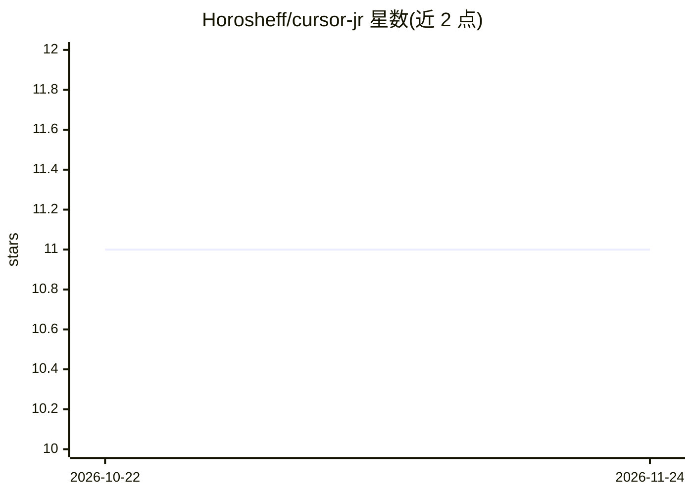

# Horosheff/cursor-jr

⭐ 11 · PowerShell · MIT · 推送 2026-07-02 · [GitHub](https://github.com/Horosheff/cursor-jr) · [官网](https://t.me/maya_pro) · 个人维护

**面向新手的 Cursor 俄语导师子代理：教学与自动化指导**

以 Cursor 子代理（readonly mentor）形式安装的俄语教学助手，面向首次接触 Cursor 的创业者、营销、设计与内容人员：用非技术语言解释 Ask/Plan/Agent/Debug 模式，指导 diff、checkpoints、Rules、Skills、MCP、Canvas 与 Automations 的使用，提供 7 天新手路线、典型问题排查与知识库维护子代理。安装后通过 Task(cursor-jr)、/cursor-jr 等 slash 命令调用，附 verify/health-check 脚本。知识库基于 Cursor 官方文档索引生成俄语简化卡片，为非官方项目，MIT 许可。

## 筛选速览

| 维度 | 判定 | 备注 |
|---|---|---|
| AI 角色 | `ai-native` | 本体是模型或模型工具 |
| 许可风险 | `permissive` | MIT |
| 部署形态 | `None` |  |
| 模型依赖 | — | README 未给出锁定关系 |
| 硬件要求 | — | 无带数字的原话,不猜 |
| 安装摩擦 | `low` | 无编译、无系统依赖或容器化 |
| 成熟度 | — | 结构信号不足 |

## 能力要点

- 俄语新手导师子代理，附 7 天学习路线与新手画像 profiles
- 基于 Cursor 官方文档索引的俄语简化知识卡片与 playbooks
- 安装/健康检查/知识库覆盖审计脚本（PowerShell）
- 独立 maintainer 子代理负责知识库更新

## 适用场景

- 第一次用 Cursor 时让子代理讲解各模式与安全改代码流程
- 为团队新人搭建 7 天 Cursor 上手课程
- 排查常见问题如 MCP 未出现、agent 弄坏项目

## 场景标签

`教程课程` · 领域:学习与行业

## 证据(README 行号)

> L3: **CursorJr** — русскоязычный субагент-наставник для Cursor. Он помогает обычным людям: предпринимателям, маркетолога
> L82: - `Task(cursor-jr)` — наставник для новичков.
> L111: |`knowledge-base/`|Упрощённая база знаний Cursor на русском|

## 星数曲线

2026-10-22 11 → 2026-11-24 11（+0）

---
*卡片 v1 · prompt 1.4 · 生成 2026-11-19 · 置信度 high · 依据 README sha `19ef14b403a6` · [字段定义](../../DATASET.md)*
