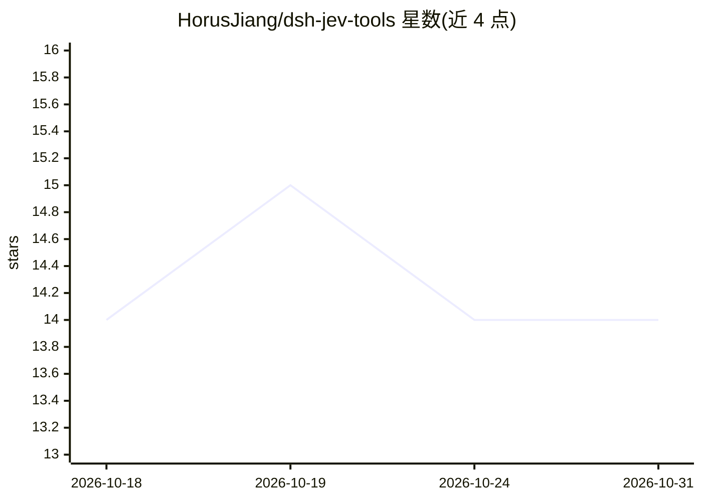

# HorusJiang/dsh-jev-tools

⭐ 14 · TypeScript · MIT · 推送 2026-10-24 · [GitHub](https://github.com/HorusJiang/dsh-jev-tools) · [官网](https://www.npmjs.com/package/dsh-jev-tools) · 个人维护 · 中文 README

**DeepSeek Harness 插件：用 Jev 判定模型先筛后放行工具输出**

一个 DeepSeek Harness（DSH）插件，把 TypeSafe 的 Jev System One 判定模型接入长会话，在四个节点上先判定再放行：超过 2000 tokens 的工具结果按段落相关性精简（保比例、fail-open、支持不改动内容的 shadow 试运行）、对 web_fetch/web_search 抓回内容做注入提醒（只提醒不拦截）、技能推荐，以及 jev_gate 在宣布完成前逐条核对声明证据（此处 fail-closed，含糊路径一律 escalate）。Jev 只返回选项与概率，不生成文本。需配置 API key，未配置时插件惰性不发请求；启用后工具输出与页面正文会发往配置的判定端点（默认 api.typesafe.ai，可改 baseUrl 指向 OpenRouter 等）。提供本地台账与度量脚本。

## 筛选速览

| 维度 | 判定 | 备注 |
|---|---|---|
| AI 角色 | `ai-ecosystem` | LLM/agent 周边工具 |
| 许可风险 | `permissive` | MIT |
| 部署形态 | `library` | 以包/库形式分发 |
| 模型依赖 | locked-api |  |
| 硬件要求 | — | 无带数字的原话,不猜 |
| 安装摩擦 | `low` | 无编译、无系统依赖或容器化 |
| 成熟度 | — | 结构信号不足 |

## 能力要点

- 工具输出按段落判定精简，确定性保底与 fail-open，另提供 shadow 试运行模式
- 注入筛查仅提醒不拦截不改写，附注入概率提示
- jev_gate 完成闸门为 fail-closed：含糊路径全部 escalate，无证据声明记 not_addressed
- 本地判定台账记录削减量、基线对比、跳过原因与成本，/jev-status 汇总

## 适用场景

- 长会话中控制工具输出占用的上下文
- agent 抓取网页后收到疑似提示注入的提醒
- 在 agent 宣布任务完成前核对声明是否有证据支持

## 场景标签

`网络安全` · 领域:学习与行业

## 证据(README 行号)

> L14: 一个 DeepSeek Harness 插件：把 **Jev** 接进长会话，在工具结果进入上下文之前做判定。
> L30: |能力|触发点|做什么|
> L32: |精简工具输出|`read` `grep` `glob` `web_fetch` `web_search` 的结果超过 2000 tokens|逐段判定与当前任务的相关性，保留相关的段落；保留是**散布**的，而不是砍掉一整块连续

## 星数曲线

2026-10-18 14 → 2026-10-31 14（+0）

---
*卡片 v1 · prompt 1.4 · 生成 2026-10-31 · 置信度 mid · 依据 README sha `4777bd45769b` · [字段定义](../../DATASET.md)*
