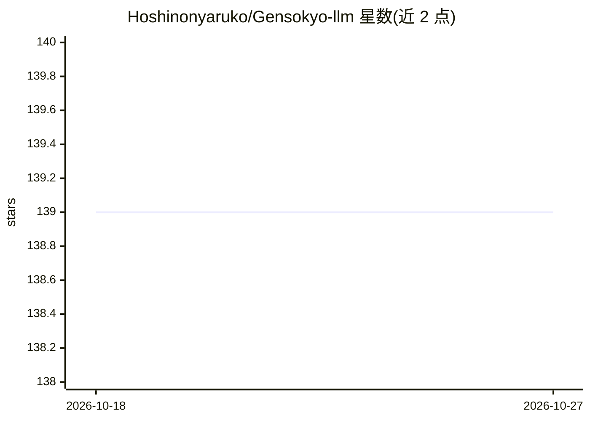

# Hoshinonyaruko/Gensokyo-llm

⭐ 139 · Go · GPL-3.0 · 推送 2026-07-10 · [GitHub](https://github.com/Hoshinonyaruko/Gensokyo-llm) · [官网](https://gensokyo.bot) · 个人维护 · 中文 README

**面向 Onebot11/Gensokyo 的大模型一键接入与统一 API 网关**

用 Go 编写的可执行程序，将腾讯混元、文心、通义、智谱、豆包、OpenAI、groq、RWKV runner、One-API 等 10+ 大模型接口转换为带 sqlite 上下文维护的统一 OpenAI 风格 API，支持 SSE 流式、多配置文件角色卡与动态配置覆盖。可一键对接 Gensokyo 框架接入 QQ/Discord/Kook/Telegram/微信公众号等 6 类聊天平台，或作为独立 API 服务运行。内置文本控制流故事模式与多层安全措施（向量敏感词、AhoCorasick 替换、文本审核接口）。限制：原生 Android 暂不支持，arm 等架构需自行本地编译。

## 筛选速览

| 维度 | 判定 | 备注 |
|---|---|---|
| AI 角色 | `ai-ecosystem` | LLM/agent 周边工具 |
| 许可风险 | `viral` | GPL-3.0 |
| 部署形态 | `None` |  |
| 模型依赖 | — | README 未给出锁定关系 |
| 硬件要求 | — | 无带数字的原话,不猜 |
| 安装摩擦 | `low` | 无编译、无系统依赖或容器化 |
| 成熟度 | `idea` | |

## 能力要点

- 10+ 大模型 API 统一转换为带上下文的 OpenAI 风格 API，支持 SSE 流式
- 一键对接 Gensokyo 框架接入 QQ/Discord/Kook/Telegram 等 6 类聊天平台
- 基于多配置文件与 promptMarks 的文本控制流故事模式（分支剧情）
- 八重安全措施：模拟 QA 强化、向量敏感词、AhoCorasick 替换、文本审核接口等

## 适用场景

- 把 QQ/Discord/Telegram 等平台的机器人接入各家大模型 API
- 将多个大模型接口统一成标准 API 并自动维护对话上下文
- 用配置文件编写分支剧情类的对话故事应用

## 场景标签

`聊天机器人` `模型网关` · 领域:Agent 开发

## 证据(README 行号)

> L41: 同时对外提供带有自动上下文的openai原始风味api(经典3参数,id,parent id,messgae)
> L71: 将这些平台的api转换为统一的api结构,并提供了上下文,支持sse方式返回

## 星数曲线

2026-10-18 139 → 2026-10-27 139（+0）

---
*卡片 v1 · prompt 1.4 · 生成 2026-10-23 · 置信度 high · 依据 README sha `c50e2a6f3830` · [字段定义](../../DATASET.md)*
