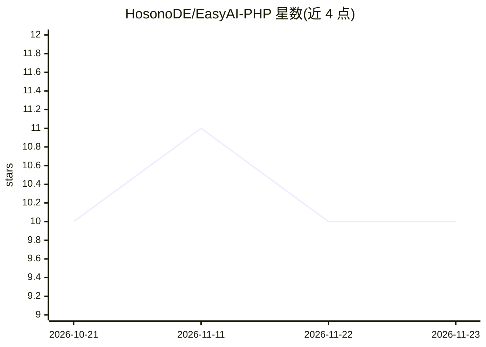

# HosonoDE/EasyAI-PHP

⭐ 10 · PHP · MIT · 推送 2026-09-12 · [GitHub](https://github.com/HosonoDE/EasyAI-PHP) · 组织维护

**为 PHP 开发者简化接入多模型与向量库的 AI 工具库**

基于 PHP 8.1+ 的开源库，定位为 PHP 版本的 LangChain 类框架，通过 Composer 安装。提供 OpenAI GPT-3.5/GPT-4 聊天助手、OpenAI 嵌入生成、Pinecone 向量数据库的增删与语义检索、Zyte API 抓取、DOM 爬取及 HTML 清洗/提取等辅助工具。底层依赖 openai-php/client、pinecone-php 等社区包。Gemini 文本生成与 Claude 3 系列在路线图中处于计划状态，README 内对其可用性表述不一致。

## 筛选速览

| 维度 | 判定 | 备注 |
|---|---|---|
| AI 角色 | `ai-ecosystem` | LLM/agent 周边工具 |
| 许可风险 | `permissive` | MIT |
| 部署形态 | `None` |  |
| 模型依赖 | — | README 未给出锁定关系 |
| 硬件要求 | — | 无带数字的原话,不猜 |
| 安装摩擦 | `low` | 无编译、无系统依赖或容器化 |
| 成熟度 | — | 结构信号不足 |

## 能力要点

- 封装 OpenAI GPT-3.5/GPT-4 聊天与嵌入助手
- 提供 Pinecone 向量的添加、删除与语义搜索
- 内置 Crawler、Zyte API、HTML 清洗/提取、异步 HTTP 等工具
- 路线图列出 Gemini、Claude 3、DALL·E 3、Whisper 等规划项

## 适用场景

- 在 PHP 项目中以少量代码调用 OpenAI 聊天接口
- 为 PHP 应用添加嵌入向量与 Pinecone 语义搜索
- 抓取并清洗网页内容以构建检索流程

## 场景标签

`Agent 框架` `RAG` · 领域:Agent 开发

## 证据(README 行号)

> L5: EasyAI-PHP is an open-source initiative designed to significantly simplify the entry into artificial intelligence fo
> L9: * **Multiple AI Models**: Incorporates OpenAI's GPT-3.5, GPT-4, and Claude 3 (Opus, Sonnet & Haiku), along with Gemi
> L10: * **AI Utilities**: Offers a variety of helpers such as vector databases from Pinecone and embeddings through OpenA

## 星数曲线

2026-10-21 10 → 2026-11-23 10（+0）

---
*卡片 v1 · prompt 1.4 · 生成 2026-11-19 · 置信度 high · 依据 README sha `b50318065a11` · [字段定义](../../DATASET.md)*
