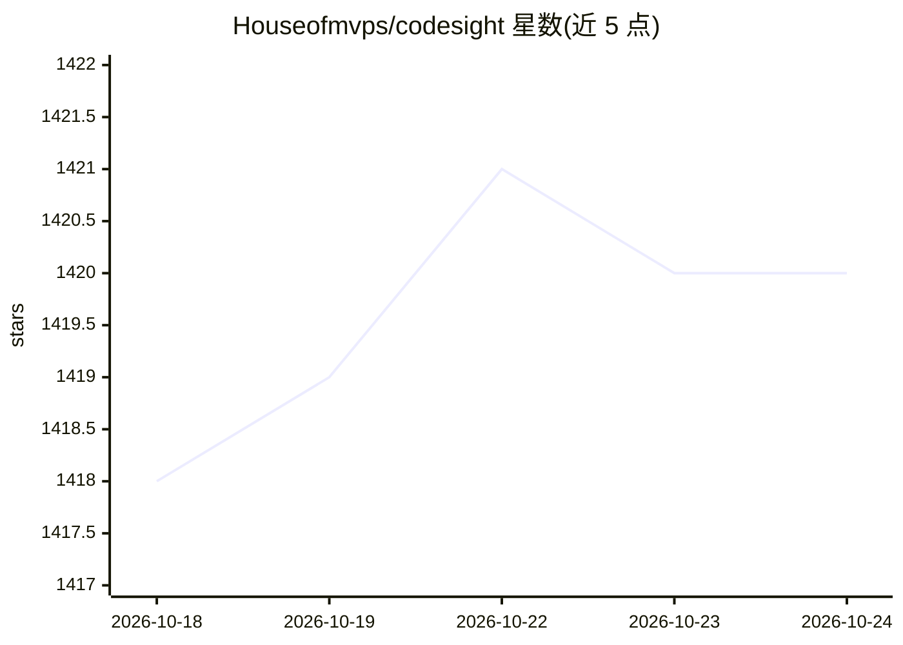

# Houseofmvps/codesight

⭐ 1,420 · TypeScript · MIT · 推送 2026-07-27 · [GitHub](https://github.com/Houseofmvps/codesight) · [官网](https://github.com/Houseofmvps/codesight) · 个人维护

**为 AI 编程助手生成代码库上下文地图的 CLI 工具**

零依赖的 Node.js CLI（npx codesight）扫描代码库，生成 CODESIGHT.md 上下文地图与 .codesight/wiki/ 持久知识库，供 Claude Code、Cursor、Copilot、Codex 等读取 markdown 的 AI 助手使用，减少会话中的探索 token 消耗。TypeScript 项目使用 AST 精度，其他 14 种语言用正则检测；支持 30+ 框架检测器与 14 个 ORM 解析器，提供 14 个 MCP 工具。另有 --mode knowledge 扫描 Obsidian vault、ADR、会议纪要等 markdown 笔记生成 KNOWLEDGE.md。需 Node.js >= 18。

## 筛选速览

| 维度 | 判定 | 备注 |
|---|---|---|
| AI 角色 | `ai-ecosystem` | LLM/agent 周边工具 |
| 许可风险 | `permissive` | MIT |
| 部署形态 | `library` | 以包/库形式分发 |
| 模型依赖 | — | README 未给出锁定关系 |
| 硬件要求 | — | 无带数字的原话,不猜 |
| 安装摩擦 | `low` | 无编译、无系统依赖或容器化 |
| 成熟度 | — | 结构信号不足 |

## 能力要点

- AST 精度扫描 TypeScript 项目，30+ 框架检测器与 14 个 ORM 解析器
- 生成 .codesight/wiki/ 持久知识库，含 3 个 wiki 专用 MCP 工具
- Knowledge 模式扫描 Obsidian vault、ADR、会议纪要等 markdown 笔记
- 零依赖、149 个测试、MIT 许可，支持 14 种语言

## 适用场景

- 让 Claude Code / Cursor 等编程助手用一份地图代替逐文件探索
- 跨会话持久保留代码库架构知识（wiki 提交到 git）
- 把项目决策记录、ADR 与会议纪要整理为 AI 可读的上下文

## 场景标签

`知识库管理` · 领域:知识与检索

## 证据(README 行号)

> L33: **Claude Code, Cursor, GitHub Copilot, OpenAI Codex, Windsurf, Cline, Aider**, and anything that reads markdown.
> L5: **Zero dependencies. AST precision. 30+ framework detectors. 14 ORM parsers. 14 MCP tools. One `npx` call.**

## 星数曲线

2026-10-18 1,418 → 2026-10-24 1,420（+2）

---
*卡片 v1 · prompt 1.4 · 生成 2026-10-21 · 置信度 mid · 依据 README sha `c3216f7bcdb7` · [字段定义](../../DATASET.md)*
