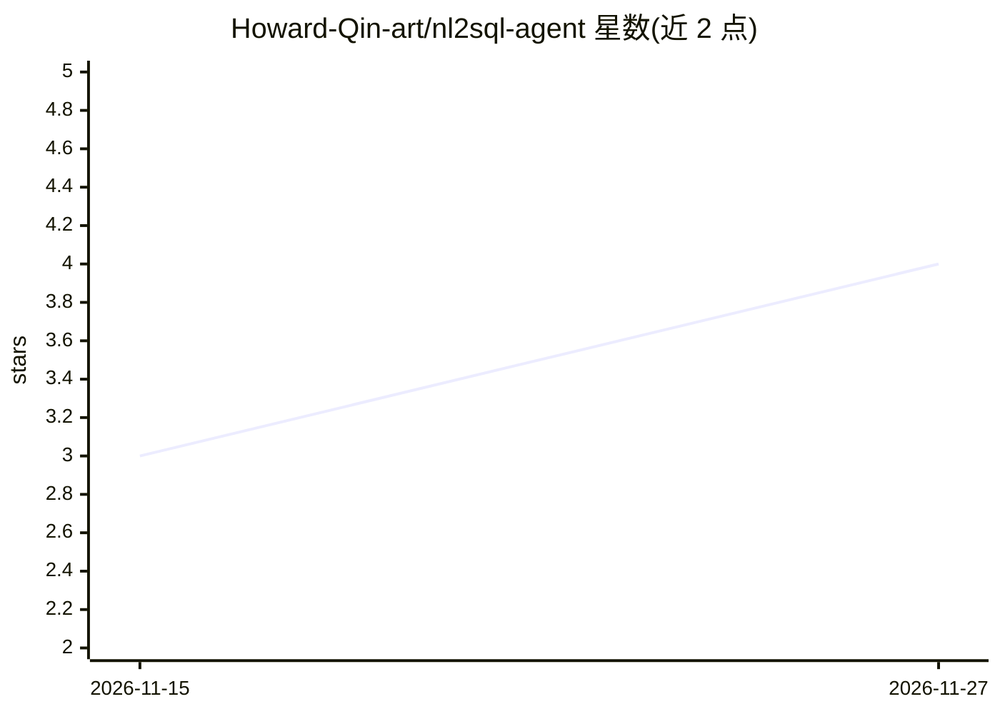

# Howard-Qin-art/nl2sql-agent

⭐ 4 · Python · 推送 2026-10-28 · [GitHub](https://github.com/Howard-Qin-art/nl2sql-agent) · 个人维护 · 中文 README

**中文自然语言转 SQL 的只读查询 Agent，附评测体系**

面向中文业务数据查询场景的 NL2SQL Agent：用户用中文提问，系统完成 Schema 召回（BM25/向量/外键反推 + RRF + 精排）、SQL 生成、sqlglot AST 安全护栏、只读执行与中文结论输出，并提供澄清反问、会话记忆与 MCP Server 集成。配套自建 60 题评测与公开数据集（DuSQL/BIRD）指标报表。需 Python 3.10+ 与一个 LLM 后端（本地 Ollama 或 OpenAI 兼容云端接口），支持 CLI、FastAPI、Streamlit 与 Docker 部署。README 明确列出局限：小模型下窗口函数与 Top-N 类查询易错，投票与自愈机制在自建数据上未验证有准确率提升。

## 筛选速览

| 维度 | 判定 | 备注 |
|---|---|---|
| AI 角色 | `ai-native` | 本体是模型或模型工具 |
| 许可风险 | `none` | — |
| 部署形态 | `self-host` | docker 或自建部署 |
| 模型依赖 | local-ok | 支持本地模型 |
| 硬件要求 | `gpu-8g` | |
| 安装摩擦 | `low` | 无编译、无系统依赖或容器化 |
| 成熟度 | — | 结构信号不足 |

## 能力要点

- sqlglot AST 白名单护栏 + 连接层只读（mode=ro / query_only）双层防护
- Schema 召回：BM25 + 字面值 + 外键反推 + 向量，RRF 融合后 LLM 精排
- MCP Server 可接入 Claude Desktop / Cursor，另提供 MCP 客户端
- 60 题自建评测 + DuSQL/BIRD 公开数据集结果与复现 manifest

## 适用场景

- 业务人员用中文查数据库，不用自己写 SQL
- 把查询能力作为 MCP 工具挂到 Claude Desktop 或 Cursor 里
- 需要只读护栏防止生成 SQL 修改数据的场景
- 复现 NL2SQL 在中英文公开数据集上的指标

## 场景标签

`数据分析` `模型评测` · 领域:效率与自动化

## 证据(README 行号)

> L3: 用中文问一句业务问题，它自己找表、写 SQL、在只读连接上查完，再把结果讲回中文。
> L7: 支持本地 Ollama，也支持任何 OpenAI 兼容接口（百炼、DeepSeek、OpenAI 都行），换后端改三行配置。

## 星数曲线

2026-11-15 3 → 2026-11-27 4（+1）

---
*卡片 v1 · prompt 1.4 · 生成 2026-11-22 · 置信度 high · 依据 README sha `80e2db4fc13b` · [字段定义](../../DATASET.md)*
