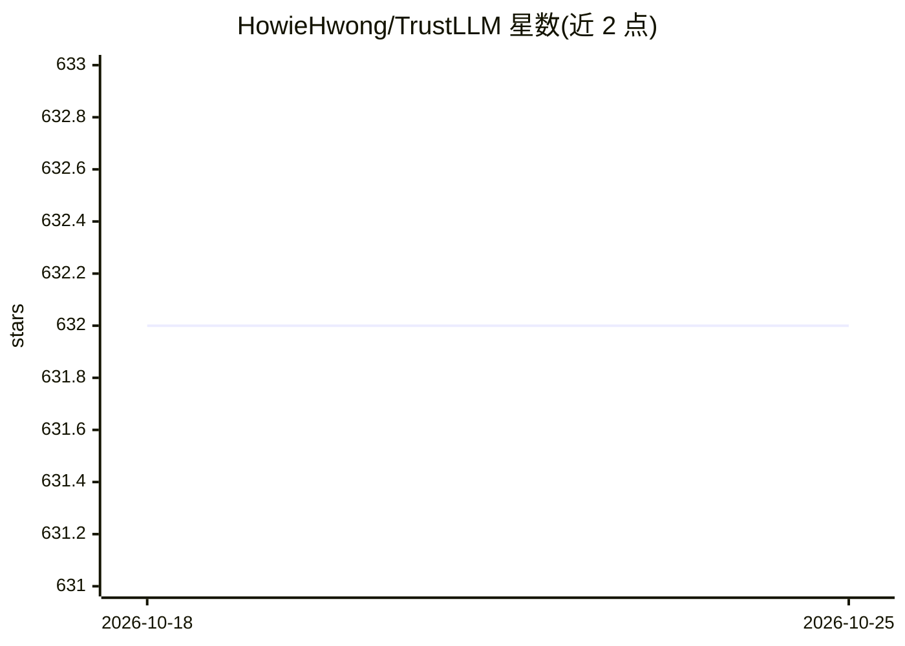

# HowieHwong/TrustLLM

⭐ 632 · Python · MIT · 推送 2026-10-04 · [GitHub](https://github.com/HowieHwong/TrustLLM) · [官网](https://trustllmbenchmark.github.io/TrustLLM-Website/) · 组织维护

**评测 LLM 可信度的研究工具包：六维度基准与评分**

ICML 2024 论文配套的开源研究工具包，用于评估大语言模型在真实性、安全性、公平性、鲁棒性、隐私、伦理六个维度的可信度。通过 pip 从 GitHub 源码安装基础包即可用 API 模式生成回答，无需 GPU 库；安装 local 扩展可加载本地 Hugging Face 权重（Transformers 模型，支持 cpu/cuda/mps 设备选择），eval 扩展用于评分。提供 CLI（download/tasks/generate/evaluate）与 Python API，输出 JSON 与 HTML 报告；评分按任务使用规则、下载的分类器、嵌入或 API judge。限制：0.4 版生成格式与原论文设置不等价，原引擎已归档。

## 筛选速览

| 维度 | 判定 | 备注 |
|---|---|---|
| AI 角色 | `ai-ecosystem` | LLM/agent 周边工具 |
| 许可风险 | `permissive` | MIT |
| 部署形态 | `library` | 以包/库形式分发 |
| 模型依赖 | — | README 未给出锁定关系 |
| 硬件要求 | — | 无带数字的原话,不猜 |
| 安装摩擦 | `medium` | 含编译或系统依赖之一 |
| 成熟度 | — | 结构信号不足 |

## 能力要点

- 六维度可信度评测：真实性/安全/公平/鲁棒性/隐私/伦理
- 支持 API 模式与本地权重（Transformers）两种生成后端
- CLI 与 Python 双入口，JSON 配置、断点续跑与 HTML 报告
- 评分方式按任务可为规则、分类器、嵌入或 API judge

## 适用场景

- 对自有模型或 API 模型跑 ICML 2024 可信度基准
- 研究幻觉、越狱、刻板印象等可信度子维度
- 用 CLI/Python 编排自动化评测并获取 JSON 结果

## 场景标签

`模型评测` · 领域:评测与运维

## 证据(README 行号)

> L18: TrustLLM is an open research toolkit for evaluating the trustworthiness of large language models across **six dimen
> L82: python -m trustllm evaluate --task safety --data runs/api-safety-full
> L85: Replace the path with your **full-run** output directory. Scores are written to `scores.json` and `scores.html`; in

## 星数曲线

2026-10-18 632 → 2026-10-25 632（+0）

---
*卡片 v1 · prompt 1.4 · 生成 2026-10-21 · 置信度 mid · 依据 README sha `1a0919e16b5b` · [字段定义](../../DATASET.md)*
