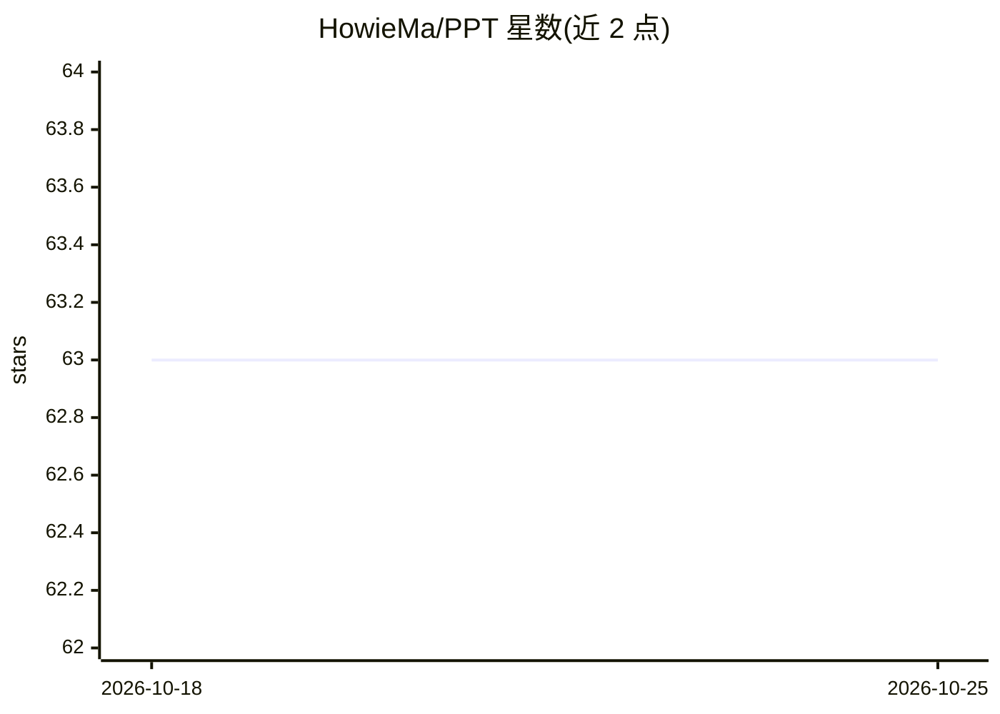

# HowieMa/PPT

⭐ 63 · Python · 推送 2026-06-01 · [GitHub](https://github.com/HowieMa/PPT) · 个人维护

**ECCV 2022 论文官方代码：token 剪枝的人体姿态估计 Transformer**

ECCV 2022 论文 "token-Pruned Pose Transformer" 的官方开源实现，面向人体姿态估计研究者。模型通过 Human Token Identification 模块定位人体区域并剪除背景 token，实现高效的单目 2D 姿态估计；在多视角场景下采用 "Human area fusion" 策略融合多视角人体区域线索进行 3D 姿态估计。仓库分为 single-view-PPT 与 multi-view-PPT 两个子目录，README 未给出具体安装命令与依赖说明，需进入各子目录查看。

## 筛选速览

| 维度 | 判定 | 备注 |
|---|---|---|
| AI 角色 | `ai-native` | 本体是模型或模型工具 |
| 许可风险 | `none` | — |
| 部署形态 | `None` |  |
| 模型依赖 | — | README 未给出锁定关系 |
| 硬件要求 | — | 无带数字的原话,不猜 |
| 安装摩擦 | `low` | 无编译、无系统依赖或容器化 |
| 成熟度 | — | 结构信号不足 |

## 能力要点

- 单目 2D 人体姿态估计的 token 剪枝 Transformer（PPT）
- Human Token Identification 模块定位人体区域并剪除背景 token
- 多视角场景的 Human area fusion 策略（multi-view PPT）
- ECCV 2022 论文官方代码，含引用条目

## 适用场景

- 复现论文中的单目/多视角人体姿态估计实验
- 在自有人体姿态数据集上训练或评估 PPT 模型
- 研究 ViT token 剪枝在姿态估计中的应用

## 场景标签

 · 领域:计算机视觉/人体姿态估计

## 证据(README 行号)

> L10: * We propose the token-Pruned Pose Transformer (PPT) for efficient 2D human pose estimation, which can locate the h
> L12: * We propose the strategy of "Human area fusion" for multi-view pose estimation. Built upon PPT, the multi-view PPT

## 星数曲线

2026-10-18 63 → 2026-10-25 63（+0）

---
*卡片 v1 · prompt 1.4 · 生成 2026-10-24 · 置信度 high · 依据 README sha `5d3039b5450c` · [字段定义](../../DATASET.md)*
