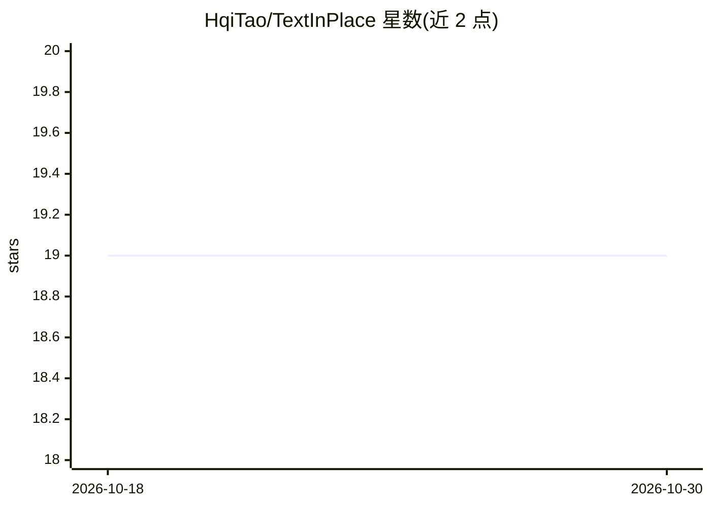

# HqiTao/TextInPlace

⭐ 19 · Python · 推送 2025-12-27 · [GitHub](https://github.com/HqiTao/TextInPlace) · [官网](https://arxiv.org/abs/2503.06501) · 个人维护

**室内视觉位置识别框架：结合场景文本检测识别重复结构**

IROS 2025 论文的官方代码，提出 TextInPlace 视觉位置识别（VPR）框架：双分支局部参数共享网络，VPR 分支以注意力聚合提取全局描述子做粗检索，STS 分支用 Bridging-Text-Spotting 检测识别场景文本，经文本相似度对 top-K 结果重排序，可选接入 LLM 做文本重排。附带自建室内 VPR 基准数据集 Maze-with-Text（1305 查询/8540 数据库图像）。训练需先在 GSV-Cities 预训练再用室内数据微调，部分数据重排格式说明标注 Coming soon。

## 筛选速览

| 维度 | 判定 | 备注 |
|---|---|---|
| AI 角色 | `ai-native` | 本体是模型或模型工具 |
| 许可风险 | `none` | — |
| 部署形态 | `library` | 以包/库形式分发 |
| 模型依赖 | — | README 未给出锁定关系 |
| 硬件要求 | — | 无带数字的原话,不猜 |
| 安装摩擦 | `medium` | 含编译或系统依赖之一 |
| 成熟度 | — | 结构信号不足 |

## 能力要点

- 双分支架构：VPR 全局描述子检索 + STS 场景文本检测识别重排序
- 发布 Maze-with-Text 室内 VPR 基准数据集
- 支持可选 LLM 文本重排（--use_llm）
- 提供评测与训练脚本及 checkpoint 下载说明

## 适用场景

- 重复结构室内环境中做机器人位置识别研究
- 在 Maze-with-Text 或公开数据集上复现论文评测结果
- 结合场景文本缓解视觉感知歧义的 VPR 方法研究

## 场景标签

`模型评测` · 领域:评测与运维

## 证据(README 行号)

> L17: This inspires us to propose TextInPlace, a simple yet effective VPR framework that integrates Scene Text Spotting (
> L18: Specifically, TextInPlace adopts a dual-branch architecture within a local parameter sharing network. The VPR branc
> L19: Finally, the discriminative text is filtered to compute text similarity and re-rank the top-K retrieved images.

## 星数曲线

2026-10-18 19 → 2026-10-30 19（+0）

---
*卡片 v1 · prompt 1.4 · 生成 2026-10-29 · 置信度 mid · 依据 README sha `f6f70b1f2523` · [字段定义](../../DATASET.md)*
