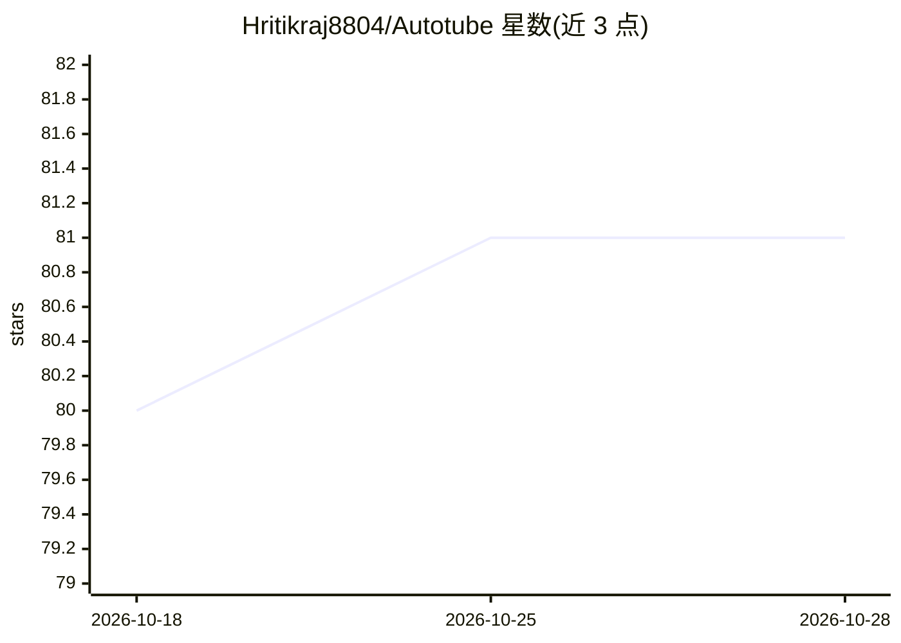

# Hritikraj8804/Autotube

⭐ 81 · Python · MIT · 推送 2025-12-16 · [GitHub](https://github.com/Hritikraj8804/Autotube) · 个人维护

**自动化 YouTube Shorts 生产流水线：主题到成片发布一站完成**

基于 n8n 工作流编排的自托管短视频自动生产系统：以本地 Ollama（LLaMA 3.1）生成约 30 秒脚本，用 Pollinations.ai 或经 HuggingFace Token 的 Z-Image 生成配图，OpenTTS 合成配音，Python API 完成 Ken Burns 缩放、交叉淡入与文字叠加的 9:16 视频合成，并经 YouTube Data API v3 上传发布。整套服务通过 Docker Compose 编排（n8n、Ollama、OpenTTS、Python API、PostgreSQL、Redis、FileBrowser）。给内容创作者与自动化搭建者使用，需自备 YouTube OAuth 凭据。

## 筛选速览

| 维度 | 判定 | 备注 |
|---|---|---|
| AI 角色 | `ai-native` | 本体是模型或模型工具 |
| 许可风险 | `permissive` | MIT |
| 部署形态 | `self-host` | docker 或自建部署 |
| 模型依赖 | local-ok | 支持本地模型 |
| 硬件要求 | — | 无带数字的原话,不猜 |
| 安装摩擦 | `low` | 无编译、无系统依赖或容器化 |
| 成熟度 | — | 结构信号不足 |

## 能力要点

- n8n 编排主题→脚本→配图→配音→合成→发布的端到端流程
- 本地 Ollama（llama3.1:8b）生成脚本，无需外部 LLM API
- Pollinations.ai（默认免 key）或 Z-Image 两种 AI 配图来源
- Docker Compose 一键部署全部 7 个服务组件

## 适用场景

- 批量自动化生产 YouTube Shorts 短视频并直接发布
- 搭建无人值守的内容生产流水线
- 在本地环境用开源模型生成脚本与配图降低成本

## 场景标签

`工作流自动化` `视频生成` · 领域:效率与自动化

## 证据(README 行号)

> L13: - 🎬 **End-to-End Automation**: From topic to published video, fully automated
> L121: 1. **Script Generation**: AI generates a 30-second script with hook, content, and CTA
> L122: 2. **Image Creation**: Multiple AI images are generated based on script sections

## 星数曲线

2026-10-18 80 → 2026-10-28 81（+1）

---
*卡片 v1 · prompt 1.4 · 生成 2026-10-24 · 置信度 mid · 依据 README sha `b4262df46995` · [字段定义](../../DATASET.md)*
