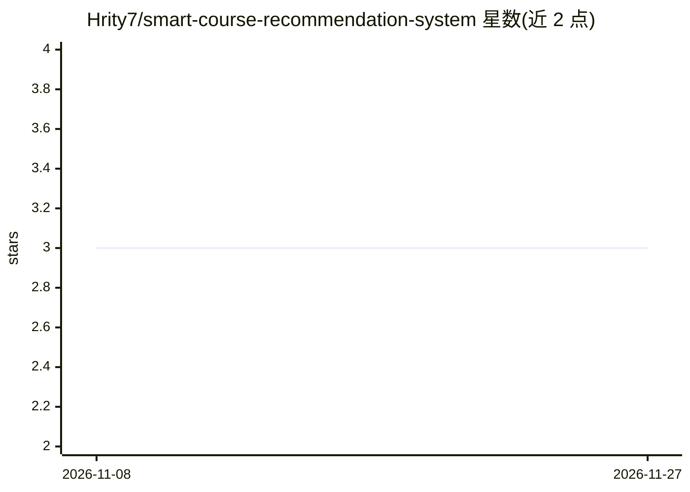

# Hrity7/smart-course-recommendation-system

⭐ 3 · TypeScript · MIT · 推送 2026-11-04 · [GitHub](https://github.com/Hrity7/smart-course-recommendation-system) · [官网](https://smart-course-recommendation-system-jbp5.onrender.com/) · 组织维护

**为学习者提供 AI 个性化课程推荐与学习路径的平台**

基于 React/TypeScript 前端与 Node.js/Express 后端的课程推荐平台：根据用户兴趣与技能生成课程推荐，规划学习路径，内置 AI Advisor 提供学习指导，并通过 YouTube API 集成学习视频资源；页面展示技能差距分析与学习路线图。运行需自备 Gemini 与 YouTube 两个 API key，README 另提及有独立的 Python 桌面应用。提供在线演示地址，托管在免费服务上，闲置后冷启动较慢。

## 筛选速览

| 维度 | 判定 | 备注 |
|---|---|---|
| AI 角色 | `ai-native` | 本体是模型或模型工具 |
| 许可风险 | `permissive` | MIT |
| 部署形态 | `library` | 以包/库形式分发 |
| 模型依赖 | — | README 未给出锁定关系 |
| 硬件要求 | — | 无带数字的原话,不猜 |
| 安装摩擦 | `low` | 无编译、无系统依赖或容器化 |
| 成熟度 | — | 结构信号不足 |

## 能力要点

- 基于用户兴趣与技能的个性化课程推荐
- AI Advisor 提供学习指导与学习路径规划
- 集成 YouTube Data API 获取学习视频
- 技能差距分析与路线图功能

## 适用场景

- 我想根据自身技能水平找合适的课程
- 我想让 AI 帮我规划一条技能学习路线
- 我想在平台里直接检索 YouTube 学习视频

## 场景标签

`推荐系统` `AI 助手` · 领域:对话与助手

## 证据(README 行号)

> L47: - **Personalized Recommendations** – Suggests courses based on users' interests and skills.
> L49: - **AI Advisor** – Provides AI-powered learning guidance.
> L61: |Gemini API|AI-powered assistance|

## 星数曲线

2026-11-08 3 → 2026-11-27 3（+0）

---
*卡片 v1 · prompt 1.4 · 生成 2026-11-22 · 置信度 high · 依据 README sha `482db5474742` · [字段定义](../../DATASET.md)*
